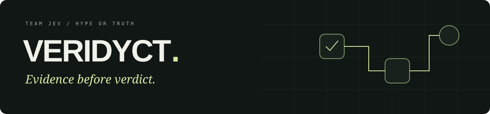
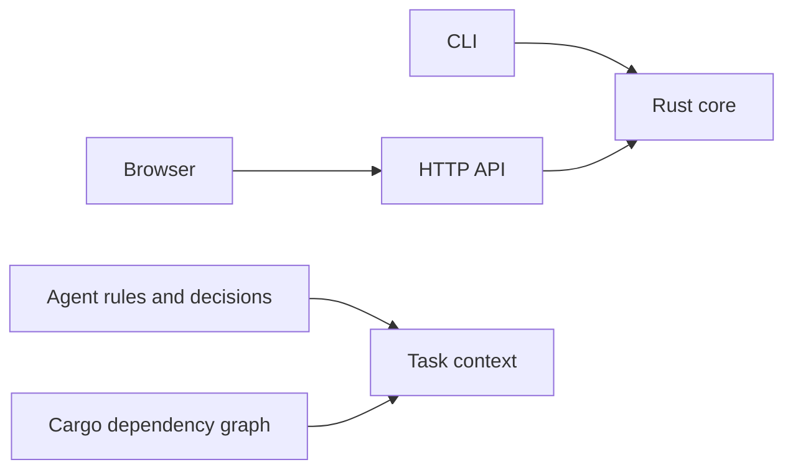

<p align="center"></p>

<p align="center">
  <a href="https://github.com/teodorbalan/VERIDYCT/actions/workflows/ci.yml"></a>
  
  
</p>

<p align="center"><strong>One repository. Shared context. Decisions you can trace.</strong><br>Built by Teo, Edi and Mihai · Team JEV · Hype or Truth</p>

---

VERIDYCT is our workspace for the QA DNA challenge. A Rust core, a command-line
adapter and a local HTTP interface live together, with portable tooling and a
versioned map of the project's rules and decisions.

**Current milestone: live offline MVP.** The workbench runs CSV rows through typed
assertion extraction and a seeded CPU Random Forest, shows source evidence and model
scores, and selects 1,000 contract-shaped claims with MMR. Architecture and stack diagrams
sit beside the live demo. Practice demonstrations include familiar training data; they
are not independent accuracy measurements.

## Start here

Install [Rust through rustup](https://www.rust-lang.org/tools/install) and Git.
The repository pins its compiler and tools; the first Cargo command installs the
requested Rust toolchain if needed. Windows users can use WSL2 or native Rust with
the MSVC C++ build tools. Linux needs a C linker; macOS needs Xcode Command Line Tools.

```sh
git clone https://github.com/teodorbalan/VERIDYCT.git
cd VERIDYCT
cargo xtask setup
cargo xtask doctor
cargo xtask dev
```

Open **http://127.0.0.1:8787**. Stop with **Ctrl+C**. Assets are embedded in the Rust
binary; restart the command after changing HTML, CSS, JavaScript or the project map.
The local app needs no API keys, Node runtime, GPU, or external frontend assets.

Prefer a ready-made Linux environment? Open the repository in a Dev Containers
compatible editor and choose **Reopen in Container**. Docker must be running.
The container installs locked dependencies automatically and forwards port 8787.

For a packaged preview:

```sh
docker compose up --build
```

This starts the live workbench at http://127.0.0.1:8787. Use `docker compose down` to
stop it. Change the host port with `VERIDYCT_PORT`; change native binding with
`VERIDYCT_ADDR`. See [development](docs/development.md) for shell examples.

## A map of the repository

```text
apps/web/          Local workbench · HTML, CSS and browser JavaScript
crates/core/       Typed assertions, Random Forest, evidence, MMR and CSV
crates/cli/        Offline file-oriented competition entry point
crates/api/        Local HTTP adapter and embedded frontend
xtask/            Cross-platform development and verification commands
contracts/        Organizer schemas and grammar, preserved
data/             Organizer practice data and lexicon, preserved
scripts/          Organizer checker, preserved
docs/             Architecture, decisions, handoffs and project knowledge map
native/           Rules for a future optional C++/CUDA extension
.devcontainer/    Reproducible Linux development environment
.github/          CI, code ownership and contribution templates
```



## Daily commands

| Command | Purpose |
| --- | --- |
| `cargo xtask doctor` | Inspect prerequisites and optional Docker/checker tools |
| `cargo xtask setup` | Download dependencies using Cargo.lock |
| `cargo xtask dev` | Start the local workbench |
| `cargo xtask check` | Formatting, Clippy, document links, graph and upstream checksums |
| `cargo xtask test` | Run workspace tests |
| `cargo xtask build` | Build release binaries |
| `cargo xtask graph` | Export the curated map and actual Cargo dependencies |
| `cargo xtask context --scope core` | Print bounded, fingerprinted context for a task |
| `cargo run --locked -p veridyct-cli -- info` | Print workspace status as JSON |

`cargo xtask arena-check` runs the official checker on Linux with Docker and Python 3.
On Windows run `powershell -ExecutionPolicy Bypass -File tools/arena-check.ps1`.
The wrapper uses the same limits and unchanged organizer output checker, retaining files
under `artifacts/`. Structural success does not establish claim truth or unseen accuracy.

See [the MVP handoff](docs/handoffs/live-mvp.md) for implementation and validation.

## Work together

1. Pick a bounded task and a human owner. Record the intended paths and acceptance criteria.
2. Create a short branch. Give concurrently working agents separate checkouts.
3. Read [AGENTS.md](AGENTS.md) and the scoped instructions before editing.
4. Run relevant checks and leave a [handoff](docs/handoffs/TEMPLATE.md).
5. Open a small PR with the behavior change and its verification. Keep `main` usable.

Example task context:

```sh
cargo xtask context --scope api --task workspace-foundation --max-chars 16000
```

The [project knowledge map](docs/knowledge/README.md) connects modules, rules, and decisions.
It is separate from the future Hooly evidence graph. Generated snapshots live in ignored
`artifacts/`, carry a source fingerprint, and never serve as an authority above the code.

## Competition boundary

The default target is **Linux amd64, 2 CPU, 6 GiB RAM, offline, non-root**. The final
image is built from the root Dockerfile. C++/CUDA is deferred; NVIDIA hardware is not
a prerequisite. LLMs may assist development, but the submitted system must not be an LLM.

The organizer's README is preserved in [UPSTREAM.md](UPSTREAM.md). Consult the
[runtime contract](contracts/README.md), [claim grammar](contracts/claim-forms.md), and
[value grammar](contracts/value-forms.md) before changing submission behavior.

The sample is scheduled for **29 October, 09:00** and submission freezes at **11:00**,
according to the organizer. Pushing to or closing the submission PR after freeze can
disqualify the team. Confirm event timing with the organizers; this README does not
override their rules.

## Further reading

[Development](docs/development.md) · [Architecture](docs/architecture.md) ·
[Agent roles](docs/agents.md) · [Knowledge map](docs/knowledge/README.md) ·
[Contribution guide](CONTRIBUTING.md) · [Documentation index](docs/README.md)
