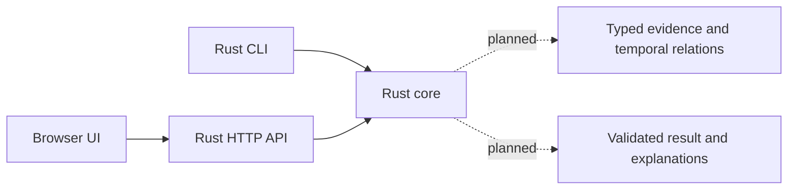

# Architecture and implementation boundaries

Status: FOUNDATION IMPLEMENTED. Workspace metadata, a CLI status command, API,
local workbench and xtask exist. The reasoning/evidence pipeline below remains planned.

## Competition profile

The default application is Rust on CPU. CLI and HTTP adapters call the same core.
The browser currently presents architecture, live workspace status and project context.
It will present solver results once those exist. Its assets are served locally.

| Boundary | Responsibility | Must not depend on |
| --- | --- | --- |
| crates/core | Workspace metadata; reserved for future evidence and reasoning | HTTP, browser, CUDA |
| crates/cli | File input/output, deadline, process exit behavior | HTTP server availability |
| crates/api | Request validation, job limits, responses, local assets | A separate implementation of reasoning |
| apps/web | Input controls, architecture diagram, results and provenance | External CDN availability |
| xtask | Development and verification commands | Competition runtime execution |
| native | Future isolated native acceleration | Inclusion in the default competition build |

## Performance rules

- Profile first. Record end-to-end latency, peak memory, input characteristics, correctness,
  compiler profile, and active CPU concurrency before making an optimization claim.
- Use bounded buffers and bounded CPU workers under the 2-CPU limit. Do not assign one
  operating-system thread per row. Account for library-created thread pools too.
- Share immutable reference data where useful; avoid speculative global caches and
  lock-heavy mutable graphs. Deterministic output ordering is explicit.
- Use exact representations for monetary values, dates, IDs, and graph keys. Model scores
  may use floating point under a documented numerical contract.
- Do not ship target-cpu=native or unconditional instructions absent from the supported
  evaluator target. Runtime feature detection needs a correct portable path.
- Every result carries source references and an explanation suitable for review.

## Future GPU profile

An explicitly requested future workload may add Rust orchestration -> a narrow native
boundary -> C++/CUDA libraries or kernels -> NVIDIA hardware. This is not part of the
competition profile, the present build, or the foundation acceptance gate.

- Start with a profiled workload and a CPU reference implementation.
- Prefer established GPU libraries for standard operations before writing custom kernels.
- Measure transfers, synchronization, allocation, kernel execution, and total runtime.
- Choose FP16/BF16 only for operations with validated error tolerances and hardware support.
  Exact facts, dates, money, and equality decisions must not silently change precision.
- Document buffer ownership, lifetimes, alignment, sizes, errors, thread safety, and
  synchronization at the FFI boundary. Do not let C++ exceptions cross a C ABI boundary.
- The default Cargo dependency graph and runtime image must remain CUDA-independent.
  GPU tests run only on designated compatible hardware; all ordinary checks still run on CPU.

See [the CPU decision](decisions/0001-cpu-first.md) and [native rules](../native/AGENTS.md).
