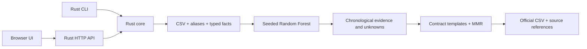

# Architecture and implementation boundaries

Status: LIVE MVP. CLI and HTTP call the same offline CPU pipeline: CSV parsing,
Mihai-derived alias normalization, typed assertion extraction, seeded Random Forest,
chronological evidence, contract claim templates, and MMR selection.

## Evidence-graph candidate

The uncommitted competition candidate adds a native CPU BiLSTM extractor, a schema
binder, exact temporal constraints and a partition-guarded boosted verifier. The
CLI opts into these stages through [Dockerfile.competition](../Dockerfile.competition).
The existing HTTP workbench shares the updated reasoning core but does not invoke
the optional native extraction adapter. Its running container has not been replaced.
See [decision 0003](decisions/0003-compiled-evidence-graph.md) and the
[current handoff](handoffs/evidence-graph-runtime.md) for measured boundaries.

## Competition profile

The default application is Rust on CPU. CLI and HTTP adapters call the same core.
The browser presents architecture and stack diagrams, source rows, live job progress,
model score distributions, assertion and evidence inspectors, generated claims and a
contract CSV download. All assets are served locally.

| Boundary | Responsibility | Must not depend on |
| --- | --- | --- |
| crates/core | Typed model, extraction, Random Forest, evidence, MMR and CSV | HTTP, browser, CUDA |
| crates/cli | File input/output, deadline, process exit behavior | HTTP server availability |
| crates/api | Request validation, job limits, responses, local assets | A separate implementation of reasoning |
| apps/web | Input controls, architecture diagram, results and provenance | External CDN availability |
| xtask | Development and verification commands | Competition runtime execution |
| native | Future isolated native acceleration | Inclusion in the default competition build |

## Performance rules

- Profile first. Record end-to-end latency, peak memory, input characteristics, correctness,
  compiler profile, and active CPU concurrency before making an optimization claim.
- Use bounded buffers and bounded CPU workers under the 2-CPU limit. Do not assign one
  operating-system thread per row. Account for library-created thread pools too.
- Share immutable reference data where useful; avoid speculative global caches and
  lock-heavy mutable graphs. Deterministic output ordering is explicit.
- Use exact representations for monetary values, dates, IDs, and graph keys. Model scores
  may use floating point under a documented numerical contract.
- Do not ship target-cpu=native or unconditional instructions absent from the supported
  evaluator target. Runtime feature detection needs a correct portable path.
- Every result carries source references and an explanation suitable for review.

## Future GPU profile

An explicitly requested future workload may add Rust orchestration -> a narrow native
boundary -> C++/CUDA libraries or kernels -> NVIDIA hardware. This is not part of the
competition profile, the present build, or the foundation acceptance gate.

- Start with a profiled workload and a CPU reference implementation.
- Prefer established GPU libraries for standard operations before writing custom kernels.
- Measure transfers, synchronization, allocation, kernel execution, and total runtime.
- Choose FP16/BF16 only for operations with validated error tolerances and hardware support.
  Exact facts, dates, money, and equality decisions must not silently change precision.
- Document buffer ownership, lifetimes, alignment, sizes, errors, thread safety, and
  synchronization at the FFI boundary. Do not let C++ exceptions cross a C ABI boundary.
- The default Cargo dependency graph and runtime image must remain CUDA-independent.
  GPU tests run only on designated compatible hardware; all ordinary checks still run on CPU.

See [the CPU decision](decisions/0001-cpu-first.md) and [native rules](../native/AGENTS.md).

## Live job contract

POST `/api/runs` accepts optional `csv` and `generate` (default true). Omitted CSV uses
practice with every fifth label hidden and removes runtime forms. GET
`/api/runs/current` returns status, actual completed-stage progress, logs, predictions,
claims, source evidence and summary. GET `/api/runs/current/output.csv` downloads a
completed result. GET `/api/dataset` exposes the public practice rows for inspection.
Only one CPU job runs at once; requests are bounded to 32 MiB and 30,000 rows. CPU work
uses a blocking worker. Failed jobs expose their error and have no downloadable result.

Practice training data is bundled as the organizer permits. Model distributions are
uncalibrated estimates. An observation's date is not an exact change boundary, and the
practice demonstration is not independent evaluation. See the
[MVP decision](decisions/0002-evidence-mvp.md).

## Evaluation and reviewed demonstrations

POST `/api/evaluation` starts a diagnostic holdout; GET on the same path returns
progress, logs and a detailed report. Reference labels remain outside prediction.
The report retains every reference/prediction pair, class metrics, confusion matrix,
coverage and a majority baseline selected from training labels only. Evaluation and
ordinary runs have separate retained results and share one CPU job limit.

GET `/api/demo-comparison` provides a curated 20-row blank-label CSV plus separately
cited LLM annotations. The ordinary predictor receives only the CSV. Download routes
under `/downloads/` expose input, review and the completed model-versus-review table.
Agreement with a development-time LLM review is distinct from measured reference
accuracy. [Presentation handoff](handoffs/presentation-integration.md) records checks.
