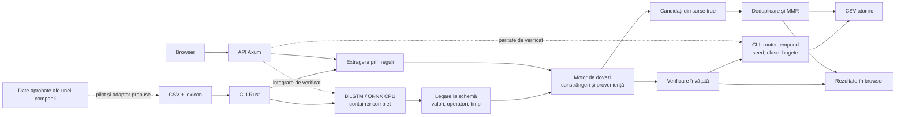

# Arhitectura explicată pentru juriu

Snapshot `0dda354`. Componentele există în mai multe trasee; unificarea completă browser–CLI este de verificat. Acest document explică sistemul și direcția integrării, fără să o implementeze.

## Harta reală și extensiile propuse



Liniile continue indică trasee prezente în cod. Cele punctate indică integrarea de verificat sau utilizarea comercială viitoare. Diagrama este logică, nu o promisiune că toate modulele rulează pe fiecare input.

## 1. Recunoașterea numelor

Lexiconul leagă nume canonice și aliasuri. Normalizarea tratează capitalizarea, spațiile și anumite semne, păstrând ambiguitățile. Indexul poate întoarce mai multe entități pentru un alias. Identificatorii rândurilor și legătura cu textul original rămân importante pentru inspecție.

Sursă: [parser internals](../../labs/assertion-extraction/HOW-IT-WORKS.md).

## 2. Categoriile care fac o afirmație verificabilă

Exemplu ilustrativ:

> From 1 April through 30 June 2026, Hooly AI Pro costs €59 per month.

| Fragment | Interpretare posibilă |
| --- | --- |
| Hooly AI Pro | Entitate din lexicon |
| costs | Indiciu pentru price |
| 59 | Valoare numerică |
| € | Monedă EUR |
| per month | Perioadă de facturare |
| 1 April through 30 June 2026 | Interval explicit |

Se păstrează operatori precum „at least”, negații și condiții. Aceste categorii sunt roluri semantice pentru afirmații, nu părți de vorbire atribuite universal tuturor tokenurilor.

Parserul separat prin reguli folosește lexicon, expresii regulate și context limitat. Extractorul nativ este alt traseu: trei BiLSTM înghețate în ONNX, cu reprezentări de cuvinte și caractere și candidați tipizați. Nu este un LLM care compune răspunsul. Nici scorul extractorului nu reprezintă adevărul propoziției.

Surse: [native parser](../handoffs/native-parser.md), [runtime nativ](../../tools/native_parser/README.md), [binding](../../crates/core/src/structured.rs).

## 3. Legarea valorii de proprietar și dimensiune

O sumă devine utilă când știm subiectul, atributul, moneda, perioada și operatorul. EUR/lună și EUR/an nu sunt interschimbabile. Aliasurile echivalente se pot normaliza; condițiile care schimbă sensul se păstrează.

O propoziție cu două clauze cere două afirmații legate corect. Dacă parserul extrage doar una, rezultatul nu dovedește automat întregul rând. Calea structurată păstrează indicii de extracție incompletă.

## 4. Dovezi, timp și conflicte

Motorul reprezintă constrângeri pozitive și negative, intervale explicite și proveniență. Data paginii nu este automat data intrării în vigoare. Două valori diferite la date diferite pot fi compatibile.

Pentru o conjuncție falsă, știm că cel puțin o componentă este falsă. Nu rezultă că toate componentele sunt false. Aceasta este o limită semantică importantă când construim graful din rânduri etichetate.

Nucleul folosește reprezentări exacte pentru valori tipizate. Portul chain păstrează aritmetica și toleranțele referinței sale. Nu descrieți întregul sistem drept exclusiv aritmetică exactă.

Sursă: [motor și limite](../handoffs/evidence-graph-runtime.md).

## 5. Verificarea și lanțul temporal condițional

Motorul combină structurile extrase cu dovezile și verificarea învățată. Candidatul complet include un lanț temporal pe chei entitate–atribut–tip–dimensiune, cu inferență Viterbi și limite de resurse.

La snapshotul consultat, `Dockerfile.competition` setează `VERIDYCT_KB_CHAIN=1`. Routerul verifică prezența seed-ului canonic și a claselor true/false. Exact practice matches, necunoscutele explicite, clauzele incomplete și cheile peste buget păstrează anumite rezultate ale motorului. Regula NOEVID este oprită.

Limită pentru Q&A: G1 poate eticheta `true` o extragere goală în traseul chain. Nu promiteți abținere universală. Confidence este un scor de model, nu o probabilitate generală calibrată.

Surse: [verificarea chain](../research/kb-chain-verification.md), [port](../handoffs/kb-chain-port.md), [configurația imaginii](../../Dockerfile.competition).

## 6. Generarea și redundanța

Generatorul pornește din observații etichetate explicit true. Predicția proprie true nu devine automat dovadă pentru generare. Candidații trec prin reguli de structură, text, noutate și limite.

În implementarea inspectată, MMR folosește aproximarea Jaccard pe amprente de tokenuri:

```text
scor de selecție = 0.78 × susținere
                 − 0.22 × suprapunerea maximă cu selecția existentă
```

Formula explică un compromis de selecție. Nu este o funcție de adevăr și nu folosește embeddings pentru echivalență semantică universală. Două afirmații foarte similare pot repeta informația, însă o singură schimbare de dată sau operator poate schimba sensul.

Sursă: [claims.rs](../../crates/core/src/claims.rs).

## 7. Execuție și recuperare

CLI-ul scrie rezultatul motorului înainte de etapa opțională chain. Înlocuiește fișierul numai când noul rezultat este valid; fallback-ul păstrează o ieșire completă. Aceasta este o alegere de robustețe utilă când există un deadline dur.

Rust oferă executabile native, ownership și control asupra memoriei, fără garbage collector obligatoriu. Bibliotecile native, inclusiv ONNX Runtime, rămân dependențe distincte. Nu atribuiți automat garanțiile safe Rust întregului cod nativ extern.

Constrângerile țintă sunt 2 CPU, 6 GiB, offline și 30 de minute. Nu preluați timpul unui experiment de pe serverul de dezvoltare drept benchmark al containerului de concurs. Fiecare măsurătoare cere versiune, hardware, configurație și input.

## 8. Ce mai înseamnă „unificare”

La snapshotul consultat, API-ul folosește direct `Engine::predict`; traseul CLI conține adaptorul nativ și routerul. Root `Dockerfile` diferă de `Dockerfile.competition`, iar resursele de model au staging local. În deck, unificarea completă rămâne marcată până când echipa confirmă: aceeași extragere, aceeași configurare, aceleași rezultate și o construcție reproductibilă din sursele predate.

Această descriere permite prezentarea arhitecturii finale propuse fără să transforme integrarea în rezultat deja demonstrat. Registrul [06](06-REZULTATE-SI-SURSE.md) păstrează toate cifrele separate pe versiuni.
