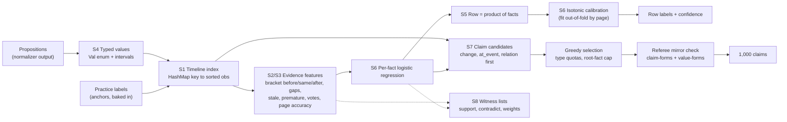

# Knowledge base research: technologies for Hype or Truth

Status: research for the team, 2026-10-28. Owner: Edi (mogaeduard). Scope: the knowledge base
that turns normalized propositions into row labels and 1,000 true claims. Normalization is out
of scope (a teammate builds it). Implementation target: Rust; Python only for labs and tests.
Interactive version with filters by step and verdict:
<https://claude.ai/artifact/NJFDojtSqqVys7a6pCCfeN> (private until shared from its Share menu).
Experiment code: [`labs/kb-experiments/`](../../../labs/kb-experiments/README.md).

## Where everything is

| What | Where |
| --- | --- |
| This report (curated, contract-checked) | [`docs/research/knowledge-base.md`](https://github.com/teodorbalan/VERIDYCT/blob/main/docs/research/knowledge-base.md) |
| Interactive atlas | <https://claude.ai/artifact/NJFDojtSqqVys7a6pCCfeN>; offline copy [`docs/research/atlas/kb-atlas.html`](https://github.com/teodorbalan/VERIDYCT/blob/main/docs/research/atlas/kb-atlas.html) |
| Atlas sources: 63-entry catalogue, report text, page template, build script | [`docs/research/atlas/`](https://github.com/teodorbalan/VERIDYCT/tree/main/docs/research/atlas) |
| Raw worker reports: truth discovery, temporal KB, blame and calibration, frontier and values, experiments | [`docs/research/notes/`](https://github.com/teodorbalan/VERIDYCT/tree/main/docs/research/notes) |
| Experiment harness (V0 to V11) and recorded results | [`labs/kb-experiments/`](https://github.com/teodorbalan/VERIDYCT/tree/main/labs/kb-experiments) |
| Diagnostics behind the error analysis | [`labs/kb-experiments/diagnostics/`](https://github.com/teodorbalan/VERIDYCT/tree/main/labs/kb-experiments/diagnostics) |

## TLDR

1. **Rules alone lose to "always true".** On practice, always-true scores 0.833. Every rule
   system tried (exact vote, latest anchor, time-decayed votes, page reliability, intervals,
   blame) lands between 0.66 and 0.75 (measured, page-held-out). Rules catch over 90% of the false
   rows but call about a quarter of the true rows false. The reason is that the first page
   stating a real change looks exactly like a lie: 150 true single-fact rows state a new value
   that only a later page confirms.
2. **The biggest lever is a learned per-fact model over "bracket" evidence.** Features say
   whether the fact matches the nearest anchor before its date, on the same day and after it,
   plus gaps, stale and premature flags and votes. Logistic regression scores each fact, a row's
   P(true) is the product over its facts, and isotonic calibration finishes it. Measured: 0.90
   to 0.91 accuracy, false precision 0.76 to 0.79, Brier 0.073 (R80; optimistic, because the
   features were designed after seeing R80 errors).
3. **Calibration works and is cheap.** Isotonic fitted on leave-one-page-out scores cuts ECE
   from about 0.16 to 0.04 on every rule and model. This is the 15% self-evaluation criterion,
   nearly for free.
4. **Truth discovery (page reliability EM) measured no gain**, even though lies cluster on pages
   (186 of 277 false rows sit on pages with two or more). The harness cannot reproduce the real
   run's 10x unlabelled votes, so keep page reliability as a feature rather than the decider.
5. **Unsure is not predictable from evidence.** The 39 unsure rows match anchors as often as
   true rows do. Emit `unsure` only where no evidence exists, and for every other row give the
   calibrated true or false.
6. **As-of claims are the riskiest output.** If you hide the last 20% of dates, the latest
   earlier anchor equals the final value for only 53% of keys. Build most of the 1,000 claims
   from `change`, `at_event` and `relation` anchored on labelled true facts. Allow a `fact` or
   `compare` only for values confirmed at the latest dates, then run every claim through a mirror
   of the referee rules.
7. **Stack: plain Rust, no engines.** The full stack is a typed value enum with intervals, a
   `HashMap` timeline index, about 150 lines of features, logistic regression (`linfa-logistic`
   or about 60 lines of hand-written code), about 50 lines of PAV, and a witness list per
   verdict. No crate exists for truth discovery or calibration. Every database and logic engine
   studied was rejected, for a stated reason.

## How to read this

- **Steps.** S1 as-of query · S2 conflicts and source reliability · S3 change over time ·
  S4 inexact values · S5 blame in multi-fact rows · S6 labelling and calibration ·
  S7 claim generation · S8 explanation.
- **Verdict.** ADOPT = build it now. TRY = build after the ADOPT stack works, keep only if it
  measures better. IDEA-ONLY = borrow the idea or the vocabulary, do not import anything.
  REJECT = do not use, with the reason stated.
- **Insanity.** 1 = an afternoon, low risk. 5 = a research project, high risk before 29 Oct 11:00.
- **Evidence.** Numbers marked "measured" come from the experiment harness below
  (`data/practice.csv`, page-held-out). Everything else is literature or reasoning, with links.

## Recommendation per step

| Step | Build now (ADOPT) | Upgrade if time (TRY) | Skip | Rust |
| --- | --- | --- | --- | --- |
| S1 as-of query | `HashMap<(subject, attribute), Vec<Obs>>` sorted by date; validity-interval facts; dates as day intervals | petgraph only for the UI graph | Any database (DuckDB, SQLite, Oxigraph, Cozo, Kuzu), interval trees | std, jiff |
| S2 conflicts, page reliability | Labelled anchors decide; unlabelled rows vote with a time kernel (tau about 7 days, symmetric); Accu-style page accuracy as a feature |  Dawid-Skene in crowd-kit as a lab oracle; per-page honest/liar latent (TKDE 2026) | Sums/Investment, GTM/KDEm, LTM, PSL/MLN, any LLM | hand-written, ~200 lines |
| S3 change over time | Bracket evidence (nearest anchor before, same day, after; gaps; stale and premature flags); attribute behaviour priors learned from data |  Per-key HMM (Viterbi + forward-backward) or segmentation DP; staleness hazard | Temporal KG embeddings, smooth time-series truth models | hand-written, ~100 lines |
| S4 inexact values | Typed `Val` enum with `to_interval()`; consistency = non-empty intersection; rules copied from `value-forms.md` | TruthFinder-style implication inside the vote | inari, uom, semver (they disagree with the referee's rules) | std |
| S5 blame | Noisy-OR: blame_i = P(fact i false) / P(row false); false multi-fact rows never act as true anchors | MaxSAT with page-liar variables | Partial-label learning | std |
| S6 labelling + calibration | Per-fact logistic regression over S2 to S4 features, row = product, isotonic on out-of-fold scores grouped by page, confidence = max(p, 1-p), `unsure` only without evidence |  Isotonic or Venn-Abers if the reliability diagram is not sigmoid; conformal threshold for the unsure band; perpetual GBM if it clearly beats LR | Snorkel label model next to a supervised stacker (double counting), embeddings | linfa-logistic or ~60 lines; ~40 lines Platt |
| S7 claim generation | Candidates from the timeline at 2026-10-29; score = product of fact P(true); greedy with type quotas and a cap per root fact; referee-mirror self-check | Conformal selection (BH) as the FDR statement | ILP unless pairwise constraints appear | std |
| S8 explanation | Witness lists per verdict (supporting and contradicting observations, page reliability, segment, LR contributions) | Evidence graph drawing in the UI | SHAP crates, argumentation semantics | std + serde |

## Recommended final version

Build order, each step measurable on the harness before the next:

1. **Value semantics (S4).** `Val` with `to_interval()`, the unit table and alias resolution,
   unit-tested with every example in `contracts/value-forms.md`. Insanity 1.
2. **Timeline index (S1).** One `Vec<Obs>` per key, sorted, with labelled anchors marked.
   Insanity 1.
3. **Bracket features (S2, S3).** Port the features from `labs/kb-experiments/v9.py`. Check
   that the Rust output matches the Python output on practice row by row. Insanity 2.
4. **Fact model and calibration (S6).** Train logistic regression and isotonic offline on all
   practice rows with page-grouped out-of-fold features, then ship the coefficients and the
   PAV table in the image. Runtime does only arithmetic. Insanity 2.
5. **Claims (S7).** Generate candidates from the timeline: `change` between two labelled true
   values, `at_event` where the event date falls between two anchors of the same value,
   `relation` while the link held, then `fact` and `compare` from values confirmed at the latest
   dates. Run greedy selection, then the referee-mirror check. Insanity 2 to 3.
6. **Witness lists (S8)** recorded at every step above, serialised for the UI. Insanity 1.
7. **Upgrades, only if the numbers move:** per-key HMM or segmentation DP, Venn-Abers for the
   unsure band, page-liar latent state, conformal selection as the FDR statement.

Expected quality to state to the jury: about 0.90 accuracy with ECE about 0.04 where the row's
key is covered by practice anchors (R80 regime, optimistic by an unknown margin), and about
0.85 or less on keys with no practice anchor (R10 stress regime). Confirm both on a holdout
the features were not designed on before quoting them.

## Measured on practice

Harness: `labs/kb-experiments/` (`exp.py` for V0 to V8, `v9.py` for V9 to V11, results files
next to them). The input is the practice `form` column. Pages are inferred as runs of
consecutive ids sharing a date (291 pages, median 7 rows). Hidden pages lose their labels but
keep their facts as votes, and a row's own page never counts as evidence for it.

- **R80:** 5-fold GroupKFold by page, 80% of pages labelled. Anchor coverage per key is close
  to the real run, where every practice row is an anchor.
- **R10:** 10 seeded splits with 10% of pages labelled (about 190 rows). This is a stress
  test for keys or subjects with no practice anchors, and the training set is tiny.

| Variant | What it adds | Acc R80 | F-rec | F-prec | ECE | Brier | Acc R10 |
| --- | --- | --- | --- | --- | --- | --- | --- |
| V0 | always true | 0.833 | 0 | 0 | 0.012 | 0.139 | 0.831 |
| V1 | exact-value vote, no time | 0.756 | 0.500 | 0.397 | 0.259 | 0.235 | 0.760 |
| V2 | latest labelled anchor before the date | 0.657 | 0.869 | 0.357 | 0.286 | 0.286 | 0.234 |
| V2b | + a new value confirmed by the next anchor counts as true | 0.740 | 0.789 | 0.464 | 0.195 | 0.194 | 0.241 |
| V3 fwd | anchors + votes, past-only time kernel | 0.690 | 0.891 | 0.360 | 0.272 | 0.279 | 0.663 |
| V3 sym | same, symmetric kernel | 0.731 | 0.942 | 0.400 | 0.161 | 0.210 | 0.697 |
| V4 | + page reliability (truth discovery) | 0.737 | 0.942 | 0.408 | 0.171 | 0.209 | 0.697 |
| V5 | + intervals for op and date precision | 0.746 | 0.942 | 0.420 | 0.166 | 0.201 | 0.699 |
| V6 | + blame pass for multi-fact false rows | 0.740 | 0.942 | 0.413 | 0.166 | 0.204 | n/a |
| V7 | rule score + isotonic + threshold | 0.826 | 0.813 | 0.484 | 0.044 | 0.100 | 0.799 |
| V8 LR | row-level logistic fusion | 0.881 | 0.395 | 0.875 | 0.034 | 0.092 | **0.851** |
| V8 HGB | row-level gradient boosting | 0.886 | 0.490 | 0.790 | 0.030 | 0.086 | 0.840 |
| V9 LR | per-fact LR over bracket features, row = product, isotonic | 0.902 | 0.675 | 0.763 | 0.038 | 0.077 | 0.816 |
| V11 | V9 + one round of self-training | **0.907** | 0.695 | 0.793 | 0.038 | 0.073 | 0.809 |

F-rec and F-prec are recall and precision of the `false` label; ECE and Brier score the
confidence of non-unsure predictions. Full confusion matrices are in the results files.

Facts verified with all labels visible:

- All 202 single-fact false rows have their key stated on a true row of another page. 276 of
  277 false rows have a fact that differs from some true anchor elsewhere, and 250 are
  contradicted by the latest true anchor at or before their date.
- Single-fact rows by match with the nearest anchor before / same day / after (Y match,
  N mismatch, - no anchor on that side): Y-Y 275 true / 0 false · N-Y (new value, confirmed later)
  150 / 18 · Y-N 130 / 23 · N-N 30 / 68 · no other anchor 79 / 0 (+7 unsure).
- 33 of 39 unsure rows have every key stated elsewhere; "no evidence" explains none of them.
- As-of test (labels hidden after 2026-09-03): the latest earlier anchor equals the final true
  value for 53.4% of keys at 75.5% coverage. Adding votes gives 50.8% at 79.4%.

Leakage, stated plainly: the shared kernel settings for V4 to V8 were fixed after seeing V3 R80
numbers, and the V9/V11 features were designed after reading R80 error examples. Treat V9/V11
as optimistic. Everything else (tau, window, thresholds, LR regularisation, isotonic fits) was
chosen on labelled pages only. The next check is a holdout these features never saw, for
example the forward-time split or the official every-fifth-row split.

Failure modes still open:

- **When a value changed is not observable between two bracketing anchors.** Example: p-499,
  80 templates on 05-20 with anchors 30 (03-20) and 80 (08-25), is false. The same pattern is
  true for 150 other rows.
- **Later restatements of an earlier figure.** p-466 and p-455 restate Q1 2026 numbers on 10-27
  and are true. The magnitude feature calls them false at confidence 1.00. This needs
  event-scoped values, for example "Q1 2026 customers".
- **Easy misses the learner still makes.** p-365 is predicted true at 0.81 although
  mismatching anchors sit on both sides, so a hard rule on N-N patterns should override the
  model.

## Combinations: what works together and what does not

| Combination | Verdict | Evidence |
| --- | --- | --- |
| Timeline rules alone (any of V1 to V6) | Does not work | Measured 0.66 to 0.76 against 0.833 for always-true: over-calls false |
| Rules + isotonic threshold (V7) | Works for calibration, not accuracy | ECE 0.044, accuracy still below always-true (0.826) |
| Evidence features + logistic regression + isotonic (V8/V9) | **Works, recommended** | 0.88 to 0.91 accuracy, ECE 0.03 to 0.04, the only family that beats always-true |
| Same with gradient boosting instead of LR | Works, slightly worse | 0.876 vs 0.902 (V9), 0.840 vs 0.851 (V8 R10); harder to explain, C++ dependency |
| Page reliability EM feeding votes | Neutral here | +0.0 (V4); untested with 10x unlabelled votes |
| Page reliability as a stage-2 model feature | Small gain | +0.4 points |
| Intervals (op, date precision) with any of the above | Works | +0.7 to +0.9 points, and required for correctness |
| Blame pass or weak negative evidence from multi-fact false rows | Neutral or harmful | -0.5 and -1.5 points |
| Self-training on unlabelled rows | Unstable | +0.5 (R80), -0.7 (R10) |
| Gap-based unsure rule | Does not work | rejected by inner selection in every split |
| Supervised LR stacker + Snorkel label model on the same signals | Do not combine | double-counts the same evidence; supervised wins when labels exist (literature) |
| Isotonic with tiny calibration sets | Risky | plateaus and overfitting with few false rows; fit on all out-of-fold practice rows, or fall back to Platt |
| Conformal selection over claims that share facts | Weakened | BH assumes near-independent p-values; cap claims per root fact first |
| Carry-forward latest anchor as the as-of value for `fact` claims | Does not work | 53% precision on the forward-time test |
| Any database, Datalog or logic engine in the runtime | Not needed | every query is a scan of one short sorted vector; engines add build and integration risk |

## Contract details that change the KB design

These come from `contracts/` and override generic advice found in the literature (two research
reports suggested the opposite and were corrected):

- Values are exact. `over 100 customers` is `gt 100`, `about 100` reads as nothing, and there is
  no rounding tolerance: do not treat `1.2 million` as a range.
- Data units are powers of 1,000 (`1 GB` states 1,000 MB). Months and years never convert to days.
- Versions compare as written: `2.3` is not `2.3.0`. Do not normalise with semver.
- Money compares only within one currency and one period; a monthly price does not state a
  one-off price. Treat a different period as a different value kind, not a contradiction.
- Names resolve through every name and alias in `lexicon.json`; a name inside a longer name names
  the longer one only (`Hooly AI Pro` is not `Hooly`).
- On the day a value changes, it already holds the new one (claim-forms, Compare section).
- `unsure` carries no confidence; an unlabelled row with no output row counts as `unsure`.
- An invalid claim still takes one of the 1,000 slots: the self-check in S7 is worth more than a
  small gain in labelling accuracy.

## Risks and open questions

- The label scoring metric is not published. The unsure threshold trades coverage for precision
  without knowing the exchange rate. Report the trade-off curve, pick one point, say why.
- Practice has 80% of rows labelled in a 5-fold split, the real run about 10%. Numbers from the
  10% regime are the ones to quote to the jury.
- New subjects, attributes and events at evaluation: every prior must be derived from data
  (attribute behaviour, staleness) with a default for unseen attributes, never hardcoded.
- The image may contain `data/practice.csv`, so the official checker's label count is an upper
  bound. Self-evaluation must come from page-held-out runs, not from `scripts/check.sh`.
- The timeline at the as-of date rests on the last observations of each key; a lie on the last
  page of a key is the most dangerous case for `fact` claims. Require two independent pages or an
  anchor for any claim.

<!-- CATALOGUE -->

## Sources and verification

Research ran on free tools only (WebSearch, WebFetch, GitHub API, crates.io API); no paid search.
Links in the catalogue were checked during the research unless an entry says otherwise. Crate
download counts and last-update dates are from the crates.io API on 2026-10-28. Items the
workers could not verify are listed under each entry or omitted.
