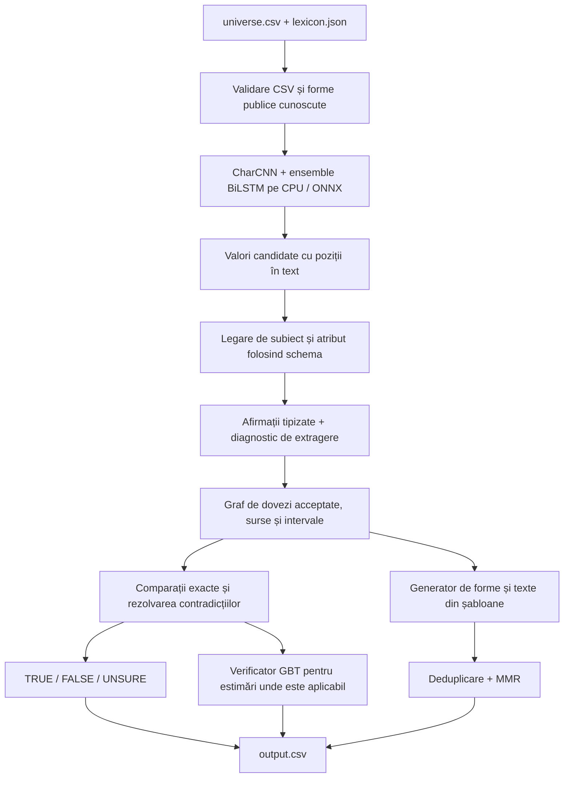

# VERIDYCT — implementarea CPU, structura de dovezi și rezultatele finale

Actualizat: 29 octombrie 2026. Implementare terminată pentru această rundă; rezultate finale obținute după înghețarea codului și modelelor. Nu s-a făcut commit, push sau deploy.

## Rezultatul care contează

Am construit un sistem complet, care primește numai `universe.csv` și `lexicon.json`, rulează fără internet și fără LLM, produce etichetele și generează 1.000 de afirmații în formatul competiției.

| Evaluare | Rezultat | Ce înseamnă |
| --- | ---: | --- |
| Univers nou, 5.000 de afirmații | **4.387/5.000 = 87,74%** | Test final nefolosit la ajustări |
| Alt univers nou, 20.000 de afirmații | **17.516/20.000 = 87,58%** | Același cod/model/configurație înghețate |
| Cele 390 de propoziții naturale de dezvoltare | **344/390 = 88,21%** | Parserul și verificatorul au fost selectate folosind dezvoltarea; nu este test orb |
| Univers independent de dezvoltare | **1.000/1.000 etichete** | După ajustări pe acest set; nu este o promisiune de generalizare |
| Generare în universul de dezvoltare | **1.000/1.000 forme adevărate** | Evaluator semantic independent, acoperire limitată pentru textul natural |
| Checker oficial de format | **Trece** | Inclusiv 20.000 de etichete și 1.000 de afirmații noi |

Pe setul final de 20.000: macro-F1 = 0,87484; sistemul a răspuns definitiv la 58,17% dintre propoziții, cu 94,42% răspunsuri corecte în această parte. Restul de 41,83% sunt `unsure`. Acuratețea de 87,58% include toate cele trei clase, inclusiv abținerile corecte și greșite.

**Nu am obținut un scor perfect pe formulări noi.** Rezultatul de 100% din dezvoltare nu trebuie confundat cu rezultatul final. Nici aceste universuri sintetice nu garantează același scor pe cele aproximativ 18.000 de propoziții reale ale organizatorilor.

## Unde sunt implementarea și livrabilele

- Checkout: `C:/Users/Teodor/orca/workspaces/QA-DNA-JEV/evidence-graph-runtime`.
- Branch: `teodorbalan/evidence-graph-runtime`.
- Commit de bază: `d0af1691d49887870eb6dd638cf439afb7e7182d`; modificările sunt necomise.
- Imagine Docker: `veridyct:competition-candidate`.
- Imagine exportată, transportabilă: `artifacts/frozen-20261029/veridyct-cpu-image.tar`.
- Codul înghețat: `artifacts/frozen-20261029/source.zip`.
- Modelele și executabilele identificate prin hash: `artifacts/frozen-20261029/freeze.json`.
- Structura compilată a dovezilor practice: `artifacts/compiled-universe.json` — aproximativ 851 KB.
- Handoff detaliat: `docs/handoffs/evidence-graph-runtime.md`.
- Cercetarea anterioară despre competiții/câștigători rămâne pe Desktop în `VERIDYCT_Cercetare_Completa_Competitii_Castigatori_Algoritmi_2026-10-28.md`.

Workbench-ul care era deja pornit nu a fost înlocuit. Candidatul nou este disponibil separat, în checkout și în imaginea Docker de mai sus.

## Stack-ul construit



### 1. Extragerea neurală

Modelul efectiv integrat este ensemble-ul `selected-v2` din experimentele BENGEE: trei modele CharCNN/BiLSTM, aproximativ 6,2 milioane de parametri în total. ONNX-ul are 24.850.029 bytes. Folosește embeddings inițializate cu GloVe și trăsături de caractere; nu este un model generativ și nu produce verdictul de adevăr.

Vocabularul nu conține toate cuvintele englezești: metadatele au 6.998 de intrări, dintre care 4.219 au avut potrivire GloVe. Embeddings ajută la sinonimele învățate, iar caracterele ajută la variații de scriere. Niciuna nu garantează înțelegerea oricărui sinonim nou.

Modelul propune perechi subiect–atribut și valori candidate. Valoarea trebuie să fie ancorată în text; modelul nu are voie să inventeze un preț din cunoștințele sale.

Portarea Rust păstrează comportamentul Python verificat pe 10.512 cazuri de codare/formă/span. Sunt păstrate sursele și hash-urile acestei verificări în `tools/native_parser/validation.json` și `docs/handoffs/native-parser.md`.

Am verificat și experimentele mai noi ale celuilalt flux de lucru:

| Variantă | Extragere exactă pe 390 | Observație |
| --- | ---: | --- |
| Ensemble selected-v2 | 336/390 | Atomic F1 92,275%; port CPU verificat |
| Factorized v2 | 339/390 | Atomic F1 91,228%; precizie atomică mai mică |
| Factorized v3 | 340/390 | Atomic F1 CPU 90,760%; nu este un câștig uniform |
| Candidate graph v3, seed alternativ | 337/390 | Câștigul specific GNN nu este demonstrat |

Nu am schimbat modelul candidat după testul final pentru a selecta retrospectiv alt scor. Factorized v3 este o alternativă serioasă pentru un A/B viitor al întregului pipeline; diferența de câteva propoziții de extragere nu dovedește un scor mai bun de verificare sau generare.

Surse locale ale acestor comparații: `extraction-factorized-v3/labs/structured-extraction/FACTORIZED.md`, commit `b84987f`; `extraction-graph-v3/labs/structured-extraction/GRAPH-EXPERIMENT.md`, commit `08cb599`. Experimentele multilabel arată și limite importante pe familii de formulări noi; nu sunt promovate automat.

### 2. Parserul care leagă afirmația de schemă

`crates/core/src/structured.rs` compilează o singură dată aliasurile și atributele lexiconului. Caută numele cele mai lungi, separă clauzele și leagă valoarea de subiectul și atributul potrivite.

Rezolvă, între altele:

- `AI Pro: price`, fără să confunde `Pro` cu atributul `pro_price`;
- subiect explicit, atribut înaintea subiectului sau valoare înaintea atributului;
- declarații `Record subject: ...` și pronume din aceeași propoziție;
- `not equal to`, `different from`, `minimum`, `no less than`, `up to` și limite stricte/inclusive;
- virgule zecimale, notație științifică, numere mari și unități sensibile la majuscule;
- descrieri precum `price [USD, per month]`, fără a le transforma în valori;
- `explicitly unrecorded (unknown)`, care nu devine accidental un boolean adevărat.

O cale importantă rămâne neurală: dacă nu există o legare sigură la schemă, păstrează propunerile modelului pentru limbajul obișnuit. Dacă o clauză rămâne neanalizată, nu poate demonstra întreaga conjuncție doar din partea extrasă.

Contextul între rânduri există ca opțiune `previous3text`, dar configurația finală folosește `none`. Adiacența în CSV nu este o garanție că două rânduri aparțin aceluiași document. Cazurile cunoscute din practice au formele publice disponibile; rezolvarea generală a unui pronume introdus cu șase rânduri înainte rămâne o limitare pentru texte complet noi.

Pe universul independent de dezvoltare, această etapă plus repararea candidaților a ajuns la 1.000/1.000 extrageri normalizate exact și 1.897/1.897 ancore procesate complet. Pe propozițiile naturale practice, extragerea a crescut de la 336 la 338/390, fără regresii de extragere exactă. Aceste două rezultate au dificultăți foarte diferite.

### 3. Structura de date / graful de dovezi

Graful este un index tipizat și temporal, compilat din date. Nu este un JSON enorm scris de un LLM din memorie.

Unitatea de bază este:

```json
{
  "subject": "Hooly AI Pro",
  "attribute": "price",
  "value": {"kind": "money", "value": 59, "currency": "EUR", "per": "month"}
}
```

Numărul de mai sus ilustrează formatul; nu îl prezint drept o valoare Hooly verificată pentru orice dată.

Fiecare observație păstrează ID-ul sursei, textul, data publicării, valoarea și intervalul de valabilitate dacă textul îl oferă explicit. Structura are indexuri pentru observații adevărate, restricții negative atomice, conjuncții false și conflicte.

Graful compilat din practice conține 1.998 de observații acceptate, 202 restricții negative atomice, 75 de conjuncții false încă nerezolvate, 39 de rânduri `unsure` și 502 proprietăți indexate.

Reguli esențiale:

1. O afirmație neetichetată nu devine adevărată pentru că apare de multe ori.
2. O predicție `true` a modelului nu devine automat dovadă acceptată.
3. O propoziție compusă etichetată `false` nu înseamnă că toate componentele ei sunt false.
4. O sursă cu dată mai nouă nu stabilește singură când s-a schimbat un atribut.
5. Lumile contrafactuale nu primesc pe ascuns adevărul din practice. Seed-ul canonic trebuie identificat complet înainte de folosirea adevărului său.

Cele aproximativ 18.000 de propoziții neetichetate de mâine pot fi extrase și indexate pentru căutare/statistici. Ele nu pot fi transformate fără justificare în 18.000 de fapte adevărate.

### 4. Raționamentul exact

Valorile numerice folosesc `BigInt`/`BigRational`, pornind de la scrierea zecimală JSON. `0.1 + 0.2` nu este tratat printr-o aproximație binară când decide adevărul.

Sunt tratate separat monedele și perioadele de facturare: EUR/lună, EUR/an și USD/lună sunt canale diferite. Unitățile fizice compatibile se convertesc exact. Duratele calendaristice nu se confundă cu un număr fix de zile.

Versiunile sunt ordonate după componente numerice: `2.10 > 2.9`. Egalitatea păstrează forma scrisă: `2.3` și `2.3.0` sunt distincte conform contractului. Am găsit și corectat o eroare de sens al comparației; sunt acum teste pentru toți cei șase operatori.

Pentru date, precizia an/lună/zi rămâne vizibilă. Un interval explicit `From ... through ...` este inclusiv și separat de data paginii. Nu umplem un interval necunoscut doar pentru că aceeași valoare apare înainte și după el.

O componentă demonstrabil falsă face conjuncția falsă. Toate componentele demonstrate adevărate pot susține `true` numai când analiza nu știe că lipsește o clauză. Conflictele și lipsa dovezii complete pot conduce la `unsure`.

### 5. Verificatorul antrenat

Am integrat gradient boosting portabil în Rust: 120 de iterații, arbori de adâncime 2, frunză minimă 20, learning rate 0,045, seed 417. Modelul folosește atribute extrase și relația cu dovezile, fără ca valorile gold ale întrebării să îi fie furnizate.

Există modele separate pentru partițiile de evaluare și pentru producție. Verificarea de apartenență respinge un checkpoint folosit cu altă partiție de antrenare. Nu folosim modelul antrenat pe tot practice pentru a pretinde un scor de holdout pe aceleași exemple.

Pe paired390, cu aceeași partiție curată de 1.507 rânduri de antrenare:

| Pipeline | Corecte | Macro-F1 |
| --- | ---: | ---: |
| Parser neural + RF | 316/390 = 81,03% | 0,35960 |
| Parser neural + GBT | 340/390 = 87,18% | 0,52163 |
| Parser cu schemă + GBT + tratarea corectă a incompletitudinii | 344/390 = 88,21% | 0,53459 |

A existat și o variantă intermediară greșită, cu prea multe abțineri: 215/390. Rezultatul este păstrat; regula a fost reparată înainte de înghețare.

Pe cele cinci split-uri ale lui Mihai, fără parserul neural care a văzut unele dintre acele exemple, noul GBT obține:

| Split | Corecte | Acuratețe |
| --- | ---: | ---: |
| random | 397/475 | 83,58% |
| bundle_group | 395/475 | 83,16% |
| template_group | 396/475 | 83,37% |
| forward_time | 481/583 | 82,50% |
| every_fifth | 328/380 | 86,32% |

Aceste teste au zero overlap de ID și text normalizat între train și test. Split-urile se suprapun între ele și sunt diagnostice, nu cinci lumi independente. Recuperarea clasei `unsure` rămâne slabă pe aceste split-uri practice.

### 6. Generarea celor 1.000 de afirmații

Generatorul construiește simultan forma formală și textul din șabloane. Produce cele cinci tipuri permise: fact, compare, change, at_event și relation.

Folosește numai dovezi etichetate adevărat. Pentru afirmații curente cere valabilitate la data de referință sau un fapt istoric adecvat. Pentru schimbări cere martori ordonați în timp; pentru relații și evenimente cere potrivirea intervalelor relevante.

Comparările de preț fără selector de monedă/perioadă sunt omise când referința este ambiguă. Comparările de date păstrează aceeași precizie. Versiunile folosesc aceeași comparație numerică exactă ca verificatorul.

După deduplicarea formei și textului, MMR selectează diversitatea: 0,78 × scorul de evidență − 0,22 × redundanța maximă. Scorul de evidență este o estimare inginerească, nu o probabilitate de adevăr calibrată.

Pe dezvoltare, evaluatorul independent confirmă adevărul tuturor celor 1.000 de forme. Verificatorul său limitat de text certifică doar 83 de formulări; 917 de texte rămân în afara gramaticii sale. Acest rezultat **nu** certifică 1.000/1.000 în fața arbitrului privat al competiției și nici toate textele naturale.

## Ce am testat și nu am promovat

Un agent separat a verificat gruparea transductivă a propozițiilor neetichetate. Media celor cinci split-uri a fost 83,9453% pentru baseline și 84,0190% pentru gruparea globală: doar două apariții de rând corect în plus, cu log loss mai slab. Gruparea temporală a scăzut la 83,7391%; `unsure` nu s-a îmbunătățit. Sunt 9.466 de comparații de invariabilitate la amestecarea corpusului și verificări de lipsă a scurgerii de etichete. Nu am introdus această complexitate în runtime.

Și experimentele GNN pentru parser au câștiguri mici sau neuniforme față de controale. Graful de dovezi este util deja ca structură și sistem de interogare; nu trebuie să aibă obligatoriu un GNN pentru a compara corect prețuri și intervale.

## Istoria rezultatelor — inclusiv eșecurile

| Rundă | Etichete corecte | Generare / observație |
| --- | ---: | --- |
| Parser native fără legarea nouă, dezvoltare independentă v3 | 52,1% | 730 afirmații, dintre care 686 adevărate |
| Prima integrare a schemei | 93,7% | 1.000 afirmații, încă 16 false |
| Schema și comparațiile reparate, dezvoltare | 100% | 1.000 forme adevărate |
| Test final nou 5.000 | 87,74% | 1.000 afirmații generate; format valid |
| Test final nou 20.000 | 87,58% | 1.000 afirmații generate; format valid |

Prototipurile v1/v2 ale evaluatorului au fost retrase după găsirea unor corelații artificiale de sampling. Seturile și rapoartele vechi sunt păstrate; rezultatele finale sunt din v3 corectat. Corecția evaluatorului pentru `inch`/`in` schimbă numai două rezultate anterior neacoperite în rezultate adevărate pe fiecare rulare de dezvoltare verificată; păstrează toate cazurile false și incerte. Rapoartele de dinainte și după corecție există separat.

## Testul final și limitele lui

Înghețare: `veridyct-cpu-20261029-final-v1`, la `2026-10-29T01:41:04.279704+00:00`.

Am rulat ambele universuri până la capăt înainte să deschid oricare scor. Solverul a primit numai cele două fișiere publice. Gold-ul nu a fost montat în container. Scorerul verifică hash-urile și creează un marker exclusiv de evaluare; nu există reevaluare „force” a aceluiași test final.

Lumile au valori contrafactuale noi și familii de formulări rezervate pentru test. Totuși, sunt produse de aceeași fabrică independentă și au un număr limitat de proprietăți/intervale reale. Nu echivalează cu 25.000 de fapte complet independente sau cu engleză nelimitată.

Setul mare are precizie pentru `true` de 97,74%, recall `true` de 74,08%, precizie pentru `false` de 91,87%, recall `false` de 90,69%, recall `unsure` de 97,97%. Sistemul se abține prea des pentru unele formulări adevărate noi și mai are erori definitive. În matricea finală sunt 2.484 de etichete greșite din 20.000.

Familiile de exprimare noi sunt principala limită vizibilă în rapoartele pe stil. Nu ar fi corect să ajustăm parserul pe acele exemple și să continuăm să numim același scor „orb”. O rundă următoare trebuie să aibă o altă rezervă de evaluare nefolosită și o comparație completă cu acest candidat înghețat.

## Încadrarea în Docker

Rulare mare: 21.897 de rânduri de intrare = 1.897 ancore + 20.000 ținte.

| Resursă | Măsurat | Limită |
| --- | ---: | ---: |
| CPU | 2 CPU | 2 CPU |
| Timp total cu pornire Docker | 86,515 s | 1.800 s |
| Memorie maximă cgroup | 767.528.960 bytes, ~732 MiB | 6 GiB |
| Imagine necomprimată | 221.169.123 bytes, ~211 MiB | 3 GiB |
| CSV final | 1.125.842 bytes | 16 MiB |
| Output total, inclusiv diagnostice | 46.744.043 bytes | 256 MiB |

Rulările finale s-au suprapus parțial, deci timpii sunt măsurători ale execuțiilor reale, nu un benchmark izolat al procesorului. Host: AMD Ryzen 9 6900HS; build release Rust 1.90.0, Linux amd64, ONNX Runtime 1.23.2.

Containerul a rulat cu UID 10001, fără rețea, root filesystem read-only, toate capabilitățile eliminate, no-new-privileges, maximum 256 procese și `/tmp` limitat la 128 MiB. Pe Windows, limita output-ului bind-mounted este verificată după execuție; nu este o cotă de filesystem impusă în timp real.

## Verificări efectiv trecute

- `cargo xtask test`: 47 de teste în workspace.
- `cargo xtask check`: formatare, Clippy cu warnings ca erori, documentație și checksum-uri de fișiere organizator.
- 24 de teste semantice pentru binder.
- 4 teste de gramatică native și 3 teste cu modelul real/fixture-urile înghețate.
- Clippy pentru extractorul nativ.
- 59 de teste pentru evaluatorul independent.
- Checkerul oficial de format, atât pe practice cât și pe output-ul de 20.000 de ținte.
- Verificări de apartenență la partiție, excludere self-evidence, precizie numerică, intervale, monede/perioade și versiuni.

Nu am modificat datele, contractele sau checker-ele organizatorilor pentru a obține aceste rezultate.

## Cum îl rulezi

Din checkout:

```powershell
# Imaginea există deja local.
docker image inspect veridyct:competition-candidate

# Pe altă mașină, importă imaginea transportabilă:
docker load --input artifacts/frozen-20261029/veridyct-cpu-image.tar

# Folderul trebuie să conțină universe.csv și lexicon.json.
powershell -NoProfile -ExecutionPolicy Bypass -File tools/run-universe.ps1 -Universe C:/cale/catre/public -Image veridyct:competition-candidate -Structured -Batching exact-length
```

Pentru rebuild din surse: stagează bundle-ul și runtime-ul nativ conform `tools/native_parser/README.md`, apoi rulează `tools/build-competition.ps1`. Fișierele mari de model sunt ignorate de Git și nu apar într-un clone nou fără acest pas. Imaginea exportată include deja executabilele, modelele și runtime-ul necesar pentru execuție offline.

## Identități verificabile

- Imagine: `sha256:0ba3ab040d1c47bf5461796a804e2f1040198e1c9b6028bde5749c73475c5b16`.
- Snapshot complet de surse: `7033e2956fdb9a2ddcaa06f47c2585b5f4b97cdd3d7a51d8b4a286f0259ab63b`.
- ONNX parser: `98eebdb851849f689c60499a9f4b2514305d520a523816b0505e98bba4523b6f`.
- Modul binder: `e04748a7df6a80204bb34c7c47ec3e883b53f85434f29e568d9579195671f3f6`.
- Verificator de producție: `007d278c95e5cffc785efb89a66ca0b2d2b9428b74f02986798dd2da716c8f59`.
- Univers final 5.000: CSV SHA256 `06707b59d6f7e53b115a83d06f8bf8e7313b121a1958f7e553354266c5a282ea`.
- Univers final 20.000: CSV SHA256 `24b78993494fa476e98dd4ec36980397252047485b9d6e53d63d088735ef2db6`.

## Rapoarte și surse ale numerelor

Toate căile următoare sunt relative la checkout-ul de integrare.

| Ce verifici | Sursă |
| --- | --- |
| Etichete finale 5.000 | `artifacts/universe-20261029-034127/final-score.json` |
| Etichete finale 20.000 | `artifacts/universe-20261029-034137/final-score.json` |
| Timpi, imagine, dimensiuni finale | `run.json` și `container.log` în aceleași două directoare |
| CSV, forme extrase și dovezi | `output/output.csv`, `output/output.diagnostics.json` în fiecare rulare |
| Dezvoltare cu toate formele generate adevărate | `artifacts/universe-20261029-033259/labels-score.json`, `claims-score-v3.json` |
| Paired390, inclusiv regresiile intermediare | `artifacts/paired390/metrics.json` și fișierele de predicții |
| Cele cinci split-uri, codul final | `artifacts/final-folds/metrics.json` |
| Graf complet al dovezilor practice | `artifacts/compiled-universe.json` |
| Compararea evaluatorului înainte/după | `artifacts/evaluator-coverage/` și `docs/handoffs/evaluator-coverage.md` |
| Proveniență parser și port CPU | `tools/native_parser/provenance.json`, `validation.json` |
| Schema, formule și teste | `crates/core/src/structured.rs`, `knowledge.rs`, `typed.rs`, `temporal.rs`, `claims.rs` |
| Experimente și decizii separate | `docs/handoffs/structured-parser.md`, `native-parser.md`, `verifier-folds.md`, `transductive-verifier.md` |
| Contracte autoritative | `UPSTREAM.md`, `contracts/README.md`, `claim-forms.md`, `value-forms.md`, `scripts/check_output.py` |

Fiecare afirmație despre performanță de mai sus are un raport local păstrat. Scorurile parserului, verificării de adevăr, generării și formatului sunt măsurători diferite.
Hash SHA256 al imaginii Docker exportate: `06a15303f20c71a971c80edef12ce0f33cd12a79a7f84ddf691b1cc5811fbdbc`. Importul cu `docker load` a fost verificat.
