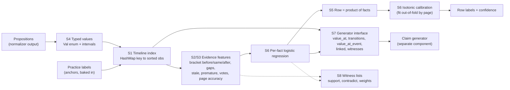

# Knowledge base research: technologies for Hype or Truth

Status: research for the team, 2026-10-28. Owner: Edi (mogaeduard). Scope: the knowledge base
that turns normalized propositions into row labels and answers the five queries the claim generator
calls. Normalization (a teammate builds it) and the generator itself are out of scope; the generator
is in [claim generation](https://github.com/teodorbalan/VERIDYCT/blob/main/docs/research/claim-generation.md). Implementation target: Rust; Python only for labs and tests.
Interactive version with filters by step and verdict:
<https://claude.ai/artifact/NJFDojtSqqVys7a6pCCfeN> (private until shared from its Share menu).
Experiment code: [`labs/kb-experiments/`](https://github.com/teodorbalan/VERIDYCT/blob/main/labs/kb-experiments/README.md).

## Where everything is

| What | Where |
| --- | --- |
| This report (curated, contract-checked) | [`docs/research/knowledge-base.md`](https://github.com/teodorbalan/VERIDYCT/blob/main/docs/research/knowledge-base.md) |
| Interactive atlas | <https://claude.ai/artifact/NJFDojtSqqVys7a6pCCfeN>; offline copy [`docs/research/atlas/kb-atlas.html`](https://github.com/teodorbalan/VERIDYCT/blob/main/docs/research/atlas/kb-atlas.html) |
| Claim generator (separate component): candidates, selection, self-check | [`docs/research/claim-generation.md`](https://github.com/teodorbalan/VERIDYCT/blob/main/docs/research/claim-generation.md) |
| Atlas sources: 59-entry catalogue, report text, page template, build script | [`docs/research/atlas/`](https://github.com/teodorbalan/VERIDYCT/tree/main/docs/research/atlas) |
| Raw worker reports: truth discovery, temporal KB, blame and calibration, frontier and values, experiments | [`docs/research/notes/`](https://github.com/teodorbalan/VERIDYCT/tree/main/docs/research/notes) |
| Experiment harness (V0 to V11) and recorded results | [`labs/kb-experiments/`](https://github.com/teodorbalan/VERIDYCT/tree/main/labs/kb-experiments) |
| Diagnostics behind the error analysis | [`labs/kb-experiments/diagnostics/`](https://github.com/teodorbalan/VERIDYCT/tree/main/labs/kb-experiments/diagnostics) |

## TLDR

1. **Rules alone lose to "always true".** On practice, always-true scores 0.833. Every rule
   system tried (exact vote, latest anchor, time-decayed votes, page reliability, intervals,
   blame) lands between 0.66 and 0.75 (measured, page-held-out). Rules catch over 90% of the false
   rows but call about a quarter of the true rows false. The reason is that the first page
   stating a real change looks exactly like a lie: 150 true single-fact rows state a new value
   that only a later page confirms.
2. **The biggest lever is a learned per-fact model over "bracket" evidence.** Features say
   whether the fact matches the nearest anchor before its date, on the same day and after it,
   plus gaps, stale and premature flags and votes. Logistic regression scores each fact, a row's
   P(true) is the product over its facts, and isotonic calibration finishes it. Measured: 0.90
   to 0.91 accuracy, false precision 0.76 to 0.79, Brier 0.073 (R80; optimistic, because the
   features were designed after seeing R80 errors).
3. **Calibration works and is cheap.** Isotonic fitted on leave-one-page-out scores cuts ECE
   from about 0.16 to 0.04 on every rule and model. This is the 15% self-evaluation criterion,
   nearly for free.
4. **Truth discovery (page reliability EM) measured no gain**, even though lies cluster on pages
   (186 of 277 false rows sit on pages with two or more). The harness cannot reproduce the real
   run's 10x unlabelled votes, so keep page reliability as a feature rather than the decider.
5. **Unsure is not predictable from evidence.** The 39 unsure rows match anchors as often as
   true rows do. Emit `unsure` only where no evidence exists, and for every other row give the
   calibrated true or false.
6. **As-of values are the weakest KB answer.** If you hide the last 20% of dates, the latest
   earlier anchor equals the final value for only 53% of keys. Every as-of answer must carry its
   P(true) and its support (pages, anchors); how the generator uses that is in [claim generation](https://github.com/teodorbalan/VERIDYCT/blob/main/docs/research/claim-generation.md).
7. **Stack: plain Rust, no engines.** The full stack is a typed value enum with intervals, a
   `HashMap` timeline index, about 150 lines of features, logistic regression (`linfa-logistic`
   or about 60 lines of hand-written code), about 50 lines of PAV, and a witness list per
   verdict. No crate exists for truth discovery or calibration. Every database and logic engine
   studied was rejected, for a stated reason.

## How to read this

- **Steps.** S1 as-of query · S2 conflicts and source reliability · S3 change over time ·
  S4 inexact values · S5 blame in multi-fact rows · S6 labelling and calibration ·
  S7 generator interface · S8 explanation.
- **Verdict.** ADOPT = build it now. TRY = build after the ADOPT stack works, keep only if it
  measures better. IDEA-ONLY = borrow the idea or the vocabulary, do not import anything.
  REJECT = do not use, with the reason stated.
- **Insanity.** 1 = an afternoon, low risk. 5 = a research project, high risk before 29 Oct 11:00.
- **Evidence.** Numbers marked "measured" come from the experiment harness below
  (`data/practice.csv`, page-held-out). Everything else is literature or reasoning, with links.

## Recommendation per step

| Step | Build now (ADOPT) | Upgrade if time (TRY) | Skip | Rust |
| --- | --- | --- | --- | --- |
| S1 as-of query | `HashMap<(subject, attribute), Vec<Obs>>` sorted by date; validity-interval facts; dates as day intervals | petgraph only for the UI graph | Any database (DuckDB, SQLite, Oxigraph, Cozo, Kuzu), interval trees | std, jiff |
| S2 conflicts, page reliability | Labelled anchors decide; unlabelled rows vote with a time kernel (tau about 7 days, symmetric); Accu-style page accuracy as a feature |  Dawid-Skene in crowd-kit as a lab oracle; per-page honest/liar latent (TKDE 2026) | Sums/Investment, GTM/KDEm, LTM, PSL/MLN, any LLM | hand-written, ~200 lines |
| S3 change over time | Bracket evidence (nearest anchor before, same day, after; gaps; stale and premature flags); attribute behaviour priors learned from data |  Per-key HMM (Viterbi + forward-backward) or segmentation DP; staleness hazard | Temporal KG embeddings, smooth time-series truth models | hand-written, ~100 lines |
| S4 inexact values | Typed `Val` enum with `to_interval()`; consistency = non-empty intersection; rules copied from `value-forms.md` | TruthFinder-style implication inside the vote | inari, uom, semver (they disagree with the referee's rules) | std |
| S5 blame | Noisy-OR: blame_i = P(fact i false) / P(row false); false multi-fact rows never act as true anchors | MaxSAT with page-liar variables | Partial-label learning | std |
| S6 labelling + calibration | Per-fact logistic regression over S2 to S4 features, row = product, isotonic on out-of-fold scores grouped by page, confidence = max(p, 1-p), `unsure` only without evidence |  Isotonic or Venn-Abers if the reliability diagram is not sigmoid; conformal threshold for the unsure band; perpetual GBM if it clearly beats LR | Snorkel label model next to a supervised stacker (double counting), embeddings | linfa-logistic or ~60 lines; ~40 lines Platt |
| S7 generator interface | Five queries, each with P(true) and witnesses: `value_at(key, date)`, `transitions(key)`, `value_at_event(key, event)`, `linked(subject, link, date)`, `witnesses(key, date)`. The generator is separate: [claim generation](https://github.com/teodorbalan/VERIDYCT/blob/main/docs/research/claim-generation.md) | Support counts (independent pages, anchors) on every answer | A database or query engine behind the queries | std |
| S8 explanation | Witness lists per verdict (supporting and contradicting observations, page reliability, segment, LR contributions) | Evidence graph drawing in the UI | SHAP crates, argumentation semantics | std + serde |

## Recommended final version

Build order, each step measurable on the harness before the next:

1. **Value semantics (S4).** `Val` with `to_interval()`, the unit table and alias resolution,
   unit-tested with every example in `contracts/value-forms.md`. Insanity 1.
2. **Timeline index (S1).** One `Vec<Obs>` per key, sorted, with labelled anchors marked.
   Insanity 1.
3. **Bracket features (S2, S3).** Port the features from `labs/kb-experiments/v9.py`. Check
   that the Rust output matches the Python output on practice row by row. Insanity 2.
4. **Fact model and calibration (S6).** Train logistic regression and isotonic offline on all
   practice rows with page-grouped out-of-fold features, then ship the coefficients and the
   PAV table in the image. Runtime does only arithmetic. Insanity 2.
5. **Generator interface (S7).** The five queries over the timeline index and the fact model,
   each returning a value with P(true), its support and its witnesses. Unit-test each on practice
   keys with known changes. Candidate rules, selection and the self-check belong to the generator
   ([claim generation](https://github.com/teodorbalan/VERIDYCT/blob/main/docs/research/claim-generation.md)). Insanity 1.
6. **Witness lists (S8)** recorded at every step above, serialised for the UI. Insanity 1.
7. **Upgrades, only if the numbers move:** per-key HMM or segmentation DP, Venn-Abers for the
   unsure band, page-liar latent state, conformal selection as the FDR statement.

Expected quality to state to the jury: about 0.90 accuracy with ECE about 0.04 where the row's
key is covered by practice anchors (R80 regime, optimistic by an unknown margin), and about
0.85 or less on keys with no practice anchor (R10 stress regime). Confirm both on a holdout
the features were not designed on before quoting them.

## Measured on practice

Harness: `labs/kb-experiments/` (`exp.py` for V0 to V8, `v9.py` for V9 to V11, results files
next to them). The input is the practice `form` column. Pages are inferred as runs of
consecutive ids sharing a date (291 pages, median 7 rows). Hidden pages lose their labels but
keep their facts as votes, and a row's own page never counts as evidence for it.

- **R80:** 5-fold GroupKFold by page, 80% of pages labelled. Anchor coverage per key is close
  to the real run, where every practice row is an anchor.
- **R10:** 10 seeded splits with 10% of pages labelled (about 190 rows). This is a stress
  test for keys or subjects with no practice anchors, and the training set is tiny.

| Variant | What it adds | Acc R80 | F-rec | F-prec | ECE | Brier | Acc R10 |
| --- | --- | --- | --- | --- | --- | --- | --- |
| V0 | always true | 0.833 | 0 | 0 | 0.012 | 0.139 | 0.831 |
| V1 | exact-value vote, no time | 0.756 | 0.500 | 0.397 | 0.259 | 0.235 | 0.760 |
| V2 | latest labelled anchor before the date | 0.657 | 0.869 | 0.357 | 0.286 | 0.286 | 0.234 |
| V2b | + a new value confirmed by the next anchor counts as true | 0.740 | 0.789 | 0.464 | 0.195 | 0.194 | 0.241 |
| V3 fwd | anchors + votes, past-only time kernel | 0.690 | 0.891 | 0.360 | 0.272 | 0.279 | 0.663 |
| V3 sym | same, symmetric kernel | 0.731 | 0.942 | 0.400 | 0.161 | 0.210 | 0.697 |
| V4 | + page reliability (truth discovery) | 0.737 | 0.942 | 0.408 | 0.171 | 0.209 | 0.697 |
| V5 | + intervals for op and date precision | 0.746 | 0.942 | 0.420 | 0.166 | 0.201 | 0.699 |
| V6 | + blame pass for multi-fact false rows | 0.740 | 0.942 | 0.413 | 0.166 | 0.204 | n/a |
| V7 | rule score + isotonic + threshold | 0.826 | 0.813 | 0.484 | 0.044 | 0.100 | 0.799 |
| V8 LR | row-level logistic fusion | 0.881 | 0.395 | 0.875 | 0.034 | 0.092 | **0.851** |
| V8 HGB | row-level gradient boosting | 0.886 | 0.490 | 0.790 | 0.030 | 0.086 | 0.840 |
| V9 LR | per-fact LR over bracket features, row = product, isotonic | 0.902 | 0.675 | 0.763 | 0.038 | 0.077 | 0.816 |
| V11 | V9 + one round of self-training | **0.907** | 0.695 | 0.793 | 0.038 | 0.073 | 0.809 |

F-rec and F-prec are recall and precision of the `false` label; ECE and Brier score the
confidence of non-unsure predictions. Full confusion matrices are in the results files.

Facts verified with all labels visible:

- All 202 single-fact false rows have their key stated on a true row of another page. 276 of
  277 false rows have a fact that differs from some true anchor elsewhere, and 250 are
  contradicted by the latest true anchor at or before their date.
- Single-fact rows by match with the nearest anchor before / same day / after (Y match,
  N mismatch, - no anchor on that side): Y-Y 275 true / 0 false · N-Y (new value, confirmed later)
  150 / 18 · Y-N 130 / 23 · N-N 30 / 68 · no other anchor 79 / 0 (+7 unsure).
- 33 of 39 unsure rows have every key stated elsewhere; "no evidence" explains none of them.
- As-of test (labels hidden after 2026-09-03): the latest earlier anchor equals the final true
  value for 53.4% of keys at 75.5% coverage. Adding votes gives 50.8% at 79.4%.

Leakage, stated plainly: the shared kernel settings for V4 to V8 were fixed after seeing V3 R80
numbers, and the V9/V11 features were designed after reading R80 error examples. Treat V9/V11
as optimistic. Everything else (tau, window, thresholds, LR regularisation, isotonic fits) was
chosen on labelled pages only. The next check is a holdout these features never saw, for
example the forward-time split or the official every-fifth-row split.

Failure modes still open:

- **When a value changed is not observable between two bracketing anchors.** Example: p-499,
  80 templates on 05-20 with anchors 30 (03-20) and 80 (08-25), is false. The same pattern is
  true for 150 other rows.
- **Later restatements of an earlier figure.** p-466 and p-455 restate Q1 2026 numbers on 10-27
  and are true. The magnitude feature calls them false at confidence 1.00. This needs
  event-scoped values, for example "Q1 2026 customers".
- **Easy misses the learner still makes.** p-365 is predicted true at 0.81 although
  mismatching anchors sit on both sides, so a hard rule on N-N patterns should override the
  model.

## Combinations: what works together and what does not

| Combination | Verdict | Evidence |
| --- | --- | --- |
| Timeline rules alone (any of V1 to V6) | Does not work | Measured 0.66 to 0.76 against 0.833 for always-true: over-calls false |
| Rules + isotonic threshold (V7) | Works for calibration, not accuracy | ECE 0.044, accuracy still below always-true (0.826) |
| Evidence features + logistic regression + isotonic (V8/V9) | **Works, recommended** | 0.88 to 0.91 accuracy, ECE 0.03 to 0.04, the only family that beats always-true |
| Same with gradient boosting instead of LR | Works, slightly worse | 0.876 vs 0.902 (V9), 0.840 vs 0.851 (V8 R10); harder to explain, C++ dependency |
| Page reliability EM feeding votes | Neutral here | +0.0 (V4); untested with 10x unlabelled votes |
| Page reliability as a stage-2 model feature | Small gain | +0.4 points |
| Intervals (op, date precision) with any of the above | Works | +0.7 to +0.9 points, and required for correctness |
| Blame pass or weak negative evidence from multi-fact false rows | Neutral or harmful | -0.5 and -1.5 points |
| Self-training on unlabelled rows | Unstable | +0.5 (R80), -0.7 (R10) |
| Gap-based unsure rule | Does not work | rejected by inner selection in every split |
| Supervised LR stacker + Snorkel label model on the same signals | Do not combine | double-counts the same evidence; supervised wins when labels exist (literature) |
| Isotonic with tiny calibration sets | Risky | plateaus and overfitting with few false rows; fit on all out-of-fold practice rows, or fall back to Platt |
| Carry-forward latest anchor as the as-of value | Does not work | 53% precision on the forward-time test |
| Any database, Datalog or logic engine in the runtime | Not needed | every query is a scan of one short sorted vector; engines add build and integration risk |

## Contract details that change the KB design

These come from `contracts/` and override generic advice found in the literature (two research
reports suggested the opposite and were corrected):

- Values are exact. `over 100 customers` is `gt 100`, `about 100` reads as nothing, and there is
  no rounding tolerance: do not treat `1.2 million` as a range.
- Data units are powers of 1,000 (`1 GB` states 1,000 MB). Months and years never convert to days.
- Versions compare as written: `2.3` is not `2.3.0`. Do not normalise with semver.
- Money compares only within one currency and one period; a monthly price does not state a
  one-off price. Treat a different period as a different value kind, not a contradiction.
- Names resolve through every name and alias in `lexicon.json`; a name inside a longer name names
  the longer one only (`Hooly AI Pro` is not `Hooly`).
- On the day a value changes, it already holds the new one (claim-forms, Compare section).
- `unsure` carries no confidence; an unlabelled row with no output row counts as `unsure`.

## Risks and open questions

- The label scoring metric is not published. The unsure threshold trades coverage for precision
  without knowing the exchange rate. Report the trade-off curve, pick one point, say why.
- Practice has 80% of rows labelled in a 5-fold split, the real run about 10%. Numbers from the
  10% regime are the ones to quote to the jury.
- New subjects, attributes and events at evaluation: every prior must be derived from data
  (attribute behaviour, staleness) with a default for unseen attributes, never hardcoded.
- The image may contain `data/practice.csv`, so the official checker's label count is an upper
  bound. Self-evaluation must come from page-held-out runs, not from `scripts/check.sh`.
- The as-of answer rests on the last observations of each key; a lie on the last page of a key
  is the most dangerous case. `value_at` reports how many independent pages and anchors support
  the value, so the generator can require two.

## Full catalogue

Sorted by first step served, then verdict, then insanity (1 = an afternoon, 5 = a research project by the deadline).

<!-- S1 -->

### In-memory timeline map

- **Kind:** data structure · **Steps:** S1 as-of query, S3 change over time, S7 generator interface · **Verdict:** ADOPT · **Insanity:** 1/5
- **What:** HashMap<(subject, attribute), Vec<Observation>> sorted by date; as-of lookup with partition_point (binary search).
- **Fit here:** 25,000 propositions is about 1 MB in memory, around 5 observations per key. Every as-of, change, at_event and relation query is a scan of one short vector.
- **Pros:** No dependency, deterministic, trivially testable; Microseconds per query on 2 CPUs; Same structure serves labelling and claim generation
- **Cons:** No query language; every query shape is a Rust function; Entity graph needs a separate adjacency list
- **Rust:** std only (HashMap, Vec, slice::partition_point)
- **Python (labs):** dict + bisect in labs
- **Why this verdict:** At this scale any database adds build and startup risk with no gain.
- **Sources:** not verified

### Validity-interval data model (Wikidata qualifiers, YAGO temporal)

- **Kind:** data model · **Steps:** S1 as-of query, S3 change over time, S7 generator interface · **Verdict:** ADOPT · **Insanity:** 1/5
- **What:** Each derived fact carries valid_from, valid_to (open = still current) and the observation ids that support it, like Wikidata start time / end time qualifiers and YAGO's time-scoped facts.
- **Fit here:** Gives the shape of the derived timeline: Fact{key, value, valid_from, valid_to: Option, support, against}. Boundaries are uncertain between two observation dates, so store both the last-seen-old and first-seen-new dates.
- **Pros:** The standard KB representation of changing facts; Directly yields change and at_event claims
- **Cons:** Assumes clean statements; ours are inferred from noisy pages
- **Rust:** a struct of about 30 lines
- **Python (labs):** dataclass
- **Why this verdict:** It is the right output format for the timeline resolver whatever algorithm fills it.
- **Sources:** <https://arxiv.org/abs/2308.11884>

### Dates as day intervals (jiff or plain day numbers)

- **Kind:** crate + representation · **Steps:** S1 as-of query, S4 inexact values · **Verdict:** ADOPT · **Insanity:** 1/5
- **What:** A date of year precision is [1 Jan, 31 Dec], month precision is the month's days, day precision is a point; store as integer day numbers.
- **Fit here:** Lets 2025-11 and 2025-11-04 agree (intersect) without being called equal, and makes before/after comparisons of events trivial.
- **Pros:** jiff 0.2.38 (247M downloads, updated 2026-10-06) has strong civil-date support; An i32 day number needs no crate at all
- **Cons:** Calendar edge cases (month lengths, leap years) must be tested once
- **Rust:** jiff 0.2.38, or time 0.3.55, or a hand-written days-from-civil function
- **Python (labs):** datetime
- **Why this verdict:** Precision handling is the core of S4 for dates and costs about 40 lines.
- **Sources:** <https://crates.io/crates/jiff>

### Time-windowed majority vote

- **Kind:** algorithm · **Steps:** S2 conflicts + source reliability, S1 as-of query · **Verdict:** ADOPT · **Insanity:** 1/5
- **What:** Among observations of a key close to the query date, the value with the most (weighted) support wins.
- **Fit here:** Measured: exact-value vote (V1) scores 0.756 accuracy (R80) against 0.833 for always-true; it catches only half the false rows. The floor every other method must beat, and the fallback when a key has no labelled anchor. Must be time-aware: an old value must not outvote the current one.
- **Pros:** About 20 lines; Strong when keys are stated 2 to 12 times
- **Cons:** Ignores page quality; Ties are common at 2 observations
- **Rust:** std
- **Python (labs):** collections.Counter
- **Why this verdict:** Baseline and fallback.
- **Sources:** not verified

### Truth discovery in a dynamic world (value lifespans, CEF)

- **Kind:** paper · **Steps:** S1 as-of query, S2 conflicts + source reliability, S3 change over time · **Verdict:** ADOPT · **Insanity:** 3/5
- **What:** Models each value's lifespan and scores sources by coverage, exactness and freshness; an HMM decides the truth path and copying over time (Dong, Berti-Equille, Srivastava, PVLDB 2(1) 2009).
- **Fit here:** Measured: reading evidence after the date is the largest rule-level gain: latest-anchor V2 to V2b (+next anchor) is +8.3 points (R80), forward-only to symmetric window is +4.1. 150 true single-fact rows are a new value confirmed only later. Exactly our 'stale versus lie' problem: a page that repeats the old price after a change may be stale (lagging) rather than lying. Implement the lifespan and freshness ideas without the copy HMM.
- **Pros:** Closest classic paper to the challenge; Separates lagging sources from liars
- **Cons:** Full model is heavy; Needs enough history per key
- **Rust:** simplified per-key decoder about 250 lines
- **Python (labs):** none maintained
- **Why this verdict:** Conceptual template for S3; take the simplified version.
- **Sources:** <https://lunadong.com/publication/lifespan_vldb.pdf>

### Entity graph with petgraph or an adjacency map

- **Kind:** crate · **Steps:** S1 as-of query, S7 generator interface, S8 explanation · **Verdict:** TRY · **Insanity:** 1/5
- **What:** Links such as cto, head_of_product, venue, owner and chair become time-stamped edges between entities.
- **Fit here:** Relation claims need: which entity did the link name, over which interval, and what did that entity's attribute hold then. A HashMap<(subject, link), timeline> does it; petgraph only helps for cycle checks or drawing.
- **Pros:** petgraph 579M downloads, stable; Graph view is a strong demo element
- **Cons:** A crate is unnecessary for lookups
- **Rust:** petgraph 0.8.3 or std HashMap
- **Python (labs):** networkx in labs
- **Why this verdict:** Start with the map; pull petgraph in only for the UI graph export.
- **Sources:** <https://crates.io/crates/petgraph>

### Bi-temporal edge invalidation (Graphiti / Zep agent memory)

- **Kind:** design pattern · **Steps:** S1 as-of query, S3 change over time · **Verdict:** IDEA-ONLY · **Insanity:** 2/5
- **What:** A popular 2025-2026 agent-memory knowledge graph: every edge has valid_at / invalid_at, and a newer contradicting edge closes the older one instead of deleting it.
- **Fit here:** The invalidation rule is the same as our timeline: a new value for a functional attribute ends the old one's interval. Graphiti uses an LLM for extraction and contradiction detection, which we must not do at runtime.
- **Pros:** Widely used (getzep/graphiti, 32k stars, pushed 2026-10-28); Shows the pattern scales and is demo-friendly
- **Cons:** LLM-driven, so only the data model transfers; No handling of lying sources
- **Rust:** no crate; the idea is 20 lines in the timeline resolver
- **Python (labs):** graphiti-core (LLM-based, do not use)
- **Why this verdict:** Good vocabulary for the architecture diagram; nothing to import.
- **Sources:** <https://github.com/getzep/graphiti>

### Rust Datalog engines (ascent, crepe, datafrog, Nemo)

- **Kind:** crate · **Steps:** S1 as-of query, S5 blame, S7 generator interface, S8 explanation · **Verdict:** IDEA-ONLY · **Insanity:** 3/5
- **What:** Declarative rules (for example: a relation fact holds if the link named the target while the attribute held the value) compiled into Rust or run by an engine.
- **Fit here:** Our rules are few and arithmetic-heavy (date intervals, unit conversion), which Datalog handles awkwardly. A plain loop is shorter.
- **Pros:** ascent 0.8.1: 698k downloads, updated 2026-08-29, lattices and parallel evaluation; Rules double as explanations
- **Cons:** Macro compile errors slow iteration; Nemo is not published as a usable crate (git dependency); Learning curve the night before a deadline
- **Rust:** ascent 0.8.1, crepe 0.2.0, datafrog 2.0.1; Nemo via git
- **Python (labs):** none needed
- **Why this verdict:** Only if the rule count explodes. Not for 29 Oct.
- **Sources:** <https://github.com/s-arash/ascent> · <https://github.com/knowsys/nemo>

### Information integration over time (Pal et al.)

- **Kind:** paper · **Steps:** S1 as-of query, S3 change over time · **Verdict:** IDEA-ONLY · **Insanity:** 4/5
- **What:** History-aware fusion where noisy sources delay or miss real-world updates (WWW 2012).
- **Fit here:** Reference for how a source can lag; heavier than we can validate by the deadline.
- **Pros:** Models delayed reporting explicitly
- **Cons:** Complex model; No code
- **Rust:** about 300 lines
- **Python (labs):** none
- **Why this verdict:** Read for the lag model only.
- **Sources:** <https://scholars.duke.edu/publication/808866>

### Interval trees (rust-lapper, iset, intervaltree)

- **Kind:** crate · **Steps:** S1 as-of query · **Verdict:** REJECT · **Insanity:** 1/5
- **What:** Stabbing queries: which intervals contain date d.
- **Fit here:** With about 5 intervals per key a linear scan beats any tree.
- **Pros:** rust-lapper 1.7M downloads, iset updated 2026-05
- **Cons:** Unneeded at our scale; intervaltree last updated 2021
- **Rust:** rust-lapper 2.0.0-beta.1, iset 0.3.3, intervaltree 0.2.7
- **Python (labs):** intervaltree
- **Why this verdict:** Complexity with no measurable gain.
- **Sources:** not verified

### Embedded databases (DuckDB, SQLite)

- **Kind:** crate · **Steps:** S1 as-of query · **Verdict:** REJECT · **Insanity:** 2/5
- **What:** SQL engines with as-of joins and window functions.
- **Fit here:** Fine for exploring practice data in labs; adds nothing to a 25k-fact Rust core.
- **Pros:** duckdb-rs active (pushed 2026-10-28), rusqlite 137M downloads; SQL is handy for ad-hoc lab queries
- **Cons:** Bundled DuckDB build is slow and large; Temporal logic still has to be written as SQL by hand
- **Rust:** duckdb 1.x, rusqlite 0.41
- **Python (labs):** duckdb, sqlite3 for labs
- **Why this verdict:** Use in Python labs only.
- **Sources:** <https://github.com/duckdb/duckdb-rs>

### Graph and RDF stores (Oxigraph, CozoDB, Kuzu, XTDB)

- **Kind:** database · **Steps:** S1 as-of query, S3 change over time · **Verdict:** REJECT · **Insanity:** 3/5
- **What:** Oxigraph: Rust RDF + SPARQL with RDF-star for statement-level time. CozoDB: Rust Datalog with time travel. Kuzu: embedded graph DB. XTDB: bitemporal SQL on the JVM.
- **Fit here:** Every as-of query becomes a hand-written filter anyway; the entity graph has a few hundred edges.
- **Pros:** Oxigraph is alive (2,004 stars, pushed 2026-10-23); XTDB's valid-time model matches our page date semantics
- **Cons:** Kuzu repository archived (last push 2025-10-10); CozoDB unmaintained since 2024-12; XTDB needs the JVM; SPARQL has no native temporal joins
- **Rust:** oxigraph 0.5.13; cozo 0.7.6 (stale); kuzu 0.11.3 (archived)
- **Python (labs):** pyoxigraph
- **Why this verdict:** Two are dead, one is JVM, one adds nothing at this size. Keep only the bitemporal idea: valid time = what the page claims, page date = when it was known.
- **Sources:** <https://github.com/oxigraph/oxigraph> · <https://github.com/kuzudb/kuzu> · <https://github.com/xtdb/xtdb>

### Heavy dataflow and solvers (differential-dataflow, egglog, clingo/telingo)

- **Kind:** crate / solver · **Steps:** S1 as-of query, S3 change over time · **Verdict:** REJECT · **Insanity:** 4/5
- **What:** Incremental dataflow, equality saturation, answer set programming with temporal operators.
- **Fit here:** None of them matches a batch job over 25k facts; telingo's time model is integer steps, not dates.
- **Pros:** clingo is a strong exact solver (pushed 2026-10-27)
- **Cons:** C++ build for clingo; Steep learning curves; No capability we need that a loop lacks
- **Rust:** differential-dataflow 0.25, egglog 3.0; clingo bindings unverified
- **Python (labs):** clingo
- **Why this verdict:** Overkill.
- **Sources:** <https://github.com/potassco/clingo>

<!-- S2 -->

### Truth discovery surveys and benchmarks

- **Kind:** paper · **Steps:** S2 conflicts + source reliability · **Verdict:** ADOPT · **Insanity:** 1/5
- **What:** Li et al. survey (SIGKDD Explorations 2016), Waguih and Berti-Equille experimental evaluation of 12 algorithms (2014), the 2025 survey by Wang, Zhang, Sheng et al., and 'Frustratingly Easy Truth Discovery' (2019).
- **Fit here:** The evaluation's main lesson: on data where one value dominates, simple and Accu-type models match complex ones, and complex ones lose on sparse data. That matches our 2 to 12 observations per key.
- **Pros:** One place to look up any method; Evidence that complexity does not pay here
- **Cons:** The 2016 survey ends in 2015; the 2025 survey was not read in full
- **Rust:** n/a
- **Python (labs):** DAFNA-EA reference code (2018, unmaintained)
- **Why this verdict:** Read the evaluation's conclusions before adding model complexity.
- **Sources:** <https://arxiv.org/abs/1505.02463> · <https://arxiv.org/abs/1409.6428> · <https://arxiv.org/abs/1905.00629> · <https://research.usq.edu.au/item/z9v28/a-survey-on-truth-discovery-concepts-methods-applications-and-opportunities>

### Attribute behaviour priors (monotone, fixed, free)

- **Kind:** heuristic · **Steps:** S3 change over time, S2 conflicts + source reliability · **Verdict:** ADOPT · **Insanity:** 1/5
- **What:** Classify each attribute from practice data: fixed (founded, launched, joined), increasing (customers, headcount, version), or free (price, lead).
- **Fit here:** Prunes impossible timelines (a launch date that changes is a lie) and sets the switch penalty per attribute. Must be learned from data, not hardcoded, to generalise to unseen attributes.
- **Pros:** About 30 lines; Large effect on lies that look like changes
- **Cons:** Unseen attributes need a default class
- **Rust:** std
- **Python (labs):** pandas in labs
- **Why this verdict:** Cheap and generalises if derived from the data.
- **Sources:** not verified

### SLiMFast (discriminative fusion with labels and source features)

- **Kind:** paper · **Steps:** S2 conflicts + source reliability, S6 labelling + calibration · **Verdict:** ADOPT · **Insanity:** 2/5
- **What:** Data fusion as logistic regression over source features, trained on ground truth when it exists and by EM when it is scarce (Joglekar, Rekatsinas, Garcia-Molina, Parameswaran, Re; SIGMOD 2017).
- **Fit here:** Closest in spirit to our setting: ~1,900 labelled rows as ground truth, ~18,000 unlabelled as evidence. Justifies the final logistic stacker over evidence features.
- **Pros:** Labels as anchors, features per source; Near-calibrated outputs; Paper gives guarantees on when to use EM vs supervised learning
- **Cons:** Our only source features are derived (page accuracy, date, size)
- **Rust:** logistic regression via linfa-logistic or about 60 lines
- **Python (labs):** scikit-learn LogisticRegression
- **Why this verdict:** The design of the final S6 model.
- **Sources:** <https://arxiv.org/abs/1512.06474>

### Temporal conflict resolution with constraints (TeCoRe, Marrying uncertainty and time)

- **Kind:** paper + system · **Steps:** S3 change over time, S2 conflicts + source reliability · **Verdict:** ADOPT · **Insanity:** 2/5
- **What:** Uncertain temporal KGs resolved by MLN/PSL with hard temporal constraints (a functional attribute has one value per time point); output is the maximum-weight consistent subset (Chekol, Pirro, Schoenfisch, Stuckenschmidt; AAAI 2017, PVLDB 10(12) 2017 demo).
- **Fit here:** This is our problem's formal statement. For one functional key it reduces to weighted interval scheduling: choose non-overlapping value intervals maximising evidence weight (anchors weigh most), exact in O(n log n).
- **Pros:** Formal grounding for the timeline resolver; Exact and fast once reduced
- **Cons:** The original system is JVM MLN/PSL
- **Rust:** weighted interval scheduling about 60 lines
- **Python (labs):** same in labs
- **Why this verdict:** Adopt the formulation, not the engine.
- **Sources:** <https://ojs.aaai.org/index.php/AAAI/article/view/10495> · <https://madoc.bib.uni-mannheim.de/42281/>

### Bracket evidence features (before, same day, after)

- **Kind:** feature design · **Steps:** S3 change over time, S6 labelling + calibration, S2 conflicts + source reliability · **Verdict:** ADOPT · **Insanity:** 2/5
- **What:** For each fact: does it match the nearest labelled anchor before its date, on the same day, after it; day gaps to each; stale flag (matches an older value only); premature flag (matches only a later value); kernel-weighted vote support; magnitude ratios to neighbouring values.
- **Fit here:** Measured: the biggest single lever. Rules reach about 0.75 accuracy (R80); a per-fact logistic model over these features reaches 0.90 to 0.91 with false precision 0.76 to 0.79 and Brier 0.073. Pattern table: a fact matching anchors on both sides is 275 true / 0 false; mismatching both sides is 30 true / 68 false; new value confirmed later is 150 true / 18 false.
- **Pros:** Turns 'change versus lie' into features the model can weigh; Each feature is a sentence in the explanation
- **Cons:** V9 features were designed after reading R80 errors, so 0.90 is optimistic; The change moment between two bracketing anchors stays unobservable (p-499, p-985); Power-of-ten feature misfires on later restatements (p-466, p-455)
- **Rust:** std, about 150 lines over the timeline index
- **Python (labs):** labs/kb-experiments/v9.py
- **Why this verdict:** The measured core of the labeller.
- **Sources:** not verified

### Dawid-Skene, GLAD, MACE (crowd-kit)

- **Kind:** library · **Steps:** S2 conflicts + source reliability, S6 labelling + calibration · **Verdict:** TRY · **Insanity:** 1/5
- **What:** EM over per-annotator confusion matrices (DS), item difficulty (GLAD), spammer detection (MACE).
- **Fit here:** Map 'page states value v for key k at date d' to an annotation and use crowd-kit in the lab to cross-check the Rust EM on practice data.
- **Pros:** Maintained Python implementations (crowd-kit 1.4.2, pushed 2025-12-01); A page's sensitivity/specificity is a direct model of lying
- **Cons:** Assumes one label space per item; No Rust crate
- **Rust:** Dawid-Skene port about 120 lines
- **Python (labs):** crowd-kit
- **Why this verdict:** Lab oracle, not runtime.
- **Sources:** <https://github.com/Toloka/crowd-kit>

### ACCU / AccuSim / AccuCopy (source accuracy and copy detection)

- **Kind:** paper + algorithm · **Steps:** S2 conflicts + source reliability, S6 labelling + calibration · **Verdict:** TRY · **Insanity:** 2/5
- **What:** Bayesian per-source accuracy A: a value's vote is the sum over its sources of ln(n*A/(1-A)); AccuSim adds similarity between values; AccuCopy discounts sources that copy each other (Dong, Berti-Equille, Srivastava, VLDB 2009).
- **Fit here:** Measured: page-reliability reweighting (V4) moved nothing (0.737 vs 0.737 R80; 0.697 vs 0.697 R10), even though lies cluster (186 of 277 false rows sit on pages with 2+ false rows). The harness cannot simulate the real run's 10x unlabelled votes, where it may matter. Pages are the sources. Run it per (key, time window), seed A from each page's labelled rows as a Beta prior, clamp labelled facts. Copy detection only if page pairs show clone-like agreement.
- **Pros:** Probabilistic, gives a posterior per value; Handles 'false is rare, true is repeated'; Copy detection catches mirrored pages
- **Cons:** Assumes one static truth per key unless run per time window; Copy detection is pairwise and noisy with few shared keys
- **Rust:** port about 200 lines (+150 for copy detection)
- **Python (labs):** about 80 lines of numpy
- **Why this verdict:** Keep page reliability as one feature of the fact model, not as the decider, until it measures better with many votes.
- **Sources:** <https://lunadong.com/publication/dependence_vldb.pdf> · <https://arxiv.org/abs/1505.02463>

### CRH (typed-loss truth discovery)

- **Kind:** paper · **Steps:** S2 conflicts + source reliability, S4 inexact values · **Verdict:** TRY · **Insanity:** 2/5
- **What:** Alternating minimisation: source weights from normalised loss, truths by weighted vote (categorical) or weighted median (numeric), with a loss per data type (Li et al., SIGMOD 2014).
- **Fit here:** Our values are typed (money, quantity, date, name), so a per-kind loss is a clean place to put S4 rules. Weights are not probabilities; calibrate afterwards.
- **Pros:** Handles heterogeneous types natively; Simple loop
- **Cons:** Uncalibrated weights; No time model
- **Rust:** about 200 lines
- **Python (labs):** a GitHub reimplementation exists but is minor
- **Why this verdict:** Borrow the typed loss inside Accu-EM.
- **Sources:** <https://cse.buffalo.edu/~jing/doc/sigmod14_crh.pdf>

### TruthFinder (value implication)

- **Kind:** paper · **Steps:** S2 conflicts + source reliability, S4 inexact values · **Verdict:** TRY · **Insanity:** 2/5
- **What:** Iterates source trust and fact confidence; similar values support each other through an implication function (Yin, Han, Yu, KDD 2007 / TKDE 2008).
- **Fit here:** The implication term is where 'gt 100' supports 'eq 120' and contradicts 'eq 80'. Use our interval rule as the implication function inside Accu-EM rather than running TruthFinder itself.
- **Pros:** Native support for inexact values; Tiny to implement
- **Cons:** Confidences saturate and are badly calibrated; Damping needs tuning
- **Rust:** about 80 to 100 lines
- **Python (labs):** truthdiscovery package
- **Why this verdict:** Take the implication idea, not the whole algorithm.
- **Sources:** <https://research.ibm.com/publications/truth-discovery-with-multiple-conflicting-information-providers-on-the-web>

### Reliable truth discovery for dynamic and dependent sources (TKDE 2026)

- **Kind:** paper · **Steps:** S2 conflicts + source reliability, S3 change over time · **Verdict:** TRY · **Insanity:** 3/5
- **What:** HMM-based models (Depen_Simple, Depen_Complex, Depen_Dynamic) for sources whose reliability and copying relations change over time (Zhang et al., IEEE TKDE 38(1), 2026).
- **Fit here:** The newest verified truth-discovery work, LLM-free, and it lands on the same HMM idea we recommend for S3. A two-state honest/liar latent per page is cheap to fit from anchors.
- **Pros:** Newest verified work in the line; Models lying and copying pages
- **Cons:** Only the abstract was read; No code found
- **Rust:** HMM forward pass about 100 lines
- **Python (labs):** none
- **Why this verdict:** Supports the HMM choice; the per-page liar state is a cheap add-on.
- **Sources:** <https://researchers.mq.edu.au/en/publications/reliable-truth-discovery-for-dynamic-and-dependent-sources/>

### Per-key HMM over candidate values (Viterbi + forward-backward)

- **Kind:** algorithm · **Steps:** S3 change over time, S2 conflicts + source reliability, S6 labelling + calibration · **Verdict:** TRY · **Insanity:** 3/5
- **What:** Hidden state = the true value at each observation date (candidates = values ever seen for the key); emissions = page states the value, with error rate from page reliability; transitions = a switch penalty, optionally forward-only for monotone attributes.
- **Fit here:** Gives the MAP timeline (Viterbi) and calibrated per-date marginals (forward-backward) in one model. State space is 2 to 4 values per key, so it is trivial to run.
- **Pros:** Integrates page reliability and change in one model; Marginals feed the confidence directly; Confirmed by the 2026 TKDE HMM truth-discovery work
- **Cons:** Switch penalty and emission rates need fitting on practice; Rare values with one observation are hard
- **Rust:** about 100 lines, no crate (hmmm is stale since 2020)
- **Python (labs):** numpy in labs
- **Why this verdict:** Not measured. The bracket-feature fact model already captures change-then-confirmation; try the HMM if errors cluster on keys with 3+ values.
- **Sources:** not verified

### On the discovery of evolving truth (DynaTD)

- **Kind:** paper · **Steps:** S2 conflicts + source reliability, S3 change over time · **Verdict:** IDEA-ONLY · **Insanity:** 2/5
- **What:** Incremental truth discovery where truths and source reliability both change as data arrives (Li et al., KDD 2015).
- **Fit here:** Sweeping pages in date order and updating page reliability as you go is a clean single pass, but our sources are one-shot pages, not streams, so reliability drift matters less.
- **Pros:** Streaming-friendly; Smooth reliability over time
- **Cons:** Designed for sensor-like streams; No code found
- **Rust:** about 150 to 200 lines
- **Python (labs):** none
- **Why this verdict:** Use only if page reliability visibly varies with page date.
- **Sources:** <https://cse.buffalo.edu/~jing/doc/kdd15_evolve.pdf>

### Semi-supervised truth discovery (Yin and Tan)

- **Kind:** paper · **Steps:** S2 conflicts + source reliability · **Verdict:** IDEA-ONLY · **Insanity:** 2/5
- **What:** Graph-based truth discovery guided by a small set of known truths (WWW 2011, pp. 217-226).
- **Fit here:** Evidence that even a few labels sharpen source trust a lot; the same effect is simpler as a Beta prior in Accu-EM.
- **Pros:** Directly addresses 'few labels, many votes'
- **Cons:** Older graph formulation
- **Rust:** about 150 lines
- **Python (labs):** none
- **Why this verdict:** Justification for anchoring, not a thing to port.
- **Sources:** <https://ir.webis.de/anthology/2011.wwwconf_conference-2011.25/>

### LTM, Latent Truth Model

- **Kind:** paper · **Steps:** S2 conflicts + source reliability, S5 blame · **Verdict:** IDEA-ONLY · **Insanity:** 3/5
- **What:** Bayesian model with separate false-positive and false-negative rates per source, for multi-valued attributes, fitted by collapsed Gibbs sampling (Zhao et al., PVLDB 5(6) 2012).
- **Fit here:** Relevant only if some attributes are sets (several values true at once). Our attributes look functional.
- **Pros:** Two-sided source quality; Multi-truth
- **Cons:** Gibbs sampling is fiddly and hard to calibrate
- **Rust:** about 250 lines
- **Python (labs):** none maintained
- **Why this verdict:** Skip unless multi-valued attributes show up.
- **Sources:** <https://arxiv.org/abs/1203.0058>

### Snorkel-style label model (weak supervision)

- **Kind:** library · **Steps:** S2 conflicts + source reliability, S6 labelling + calibration · **Verdict:** IDEA-ONLY · **Insanity:** 3/5
- **What:** Learns the accuracies of noisy labelling functions without labels and outputs probabilistic labels (Snorkel; FlyingSquid closed form).
- **Fit here:** Our signals (timeline match, page accuracy, cross-page agreement) are labelling functions. With ~1,900 real labels a supervised logistic stacker is simpler and better.
- **Pros:** Can exploit the 90% unlabelled rows; Snorkel active (6k stars, pushed 2026-10-13)
- **Cons:** Python only; Assumes conditionally independent functions
- **Rust:** about 100 to 150 lines for a simplified label model
- **Python (labs):** snorkel, flyingsquid
- **Why this verdict:** Supervised stacking wins when labels exist.
- **Sources:** <https://github.com/snorkel-team/snorkel>

### Argumentation frameworks (Dung, bipolar)

- **Kind:** theory · **Steps:** S8 explanation, S2 conflicts + source reliability · **Verdict:** IDEA-ONLY · **Insanity:** 3/5
- **What:** Attack and support relations between arguments with accepted-set semantics.
- **Fit here:** Matches 'supporting vs contradicting evidence' visually, but the semantics add nothing over weighted evidence. Draw the evidence graph from the witness lists instead.
- **Pros:** Nice demo picture
- **Cons:** No Rust tooling; Semantics add complexity, not accuracy
- **Rust:** grounded semantics about 60 lines on petgraph
- **Python (labs):** none needed
- **Why this verdict:** Use the picture, not the theory.
- **Sources:** not verified

### Scallop (probabilistic Datalog with provenance semirings)

- **Kind:** language · **Steps:** S2 conflicts + source reliability, S5 blame, S8 explanation · **Verdict:** IDEA-ONLY · **Insanity:** 4/5
- **What:** Datalog with probabilistic and top-k-proof provenance, implemented in Rust, driven mostly from Python.
- **Fit here:** Could express 'value valid at date' with probabilities and give proofs as explanations. Integration risk is high.
- **Pros:** Alive (520 stars, pushed 2026-06-26); Provenance semirings give principled explanations
- **Cons:** The crates.io crate named scallop is an unrelated bash wrapper; the library is used from source; API stability unknown
- **Rust:** from source (scallop-lang/scallop)
- **Python (labs):** scallopy
- **Why this verdict:** Interesting for a future version; too risky now.
- **Sources:** <https://github.com/scallop-lang/scallop>

### Knowledge-Based Trust and knowledge fusion (Google)

- **Kind:** paper · **Steps:** S2 conflicts + source reliability, S5 blame · **Verdict:** IDEA-ONLY · **Insanity:** 4/5
- **What:** Multi-layer model that separates extraction errors from source errors to score 119M web pages by factual accuracy (Dong et al., 2015); the knowledge-fusion study shows calibration must be its own stage.
- **Fit here:** Our propositions are machine-normalised by a teammate's parser: keep a small 'extraction noise' term so one mis-parse does not condemn a page.
- **Pros:** Separates parser error from page lies; Evidence for a separate calibration stage
- **Cons:** Full model is large; We have no extractor confidence signal
- **Rust:** about 300 lines for the full model
- **Python (labs):** none
- **Why this verdict:** Two ideas to borrow, no model to port.
- **Sources:** <https://arxiv.org/abs/1502.03519> · <https://arxiv.org/abs/1503.00302>

### Sums, Average-Log, Investment, PooledInvestment

- **Kind:** paper · **Steps:** S2 conflicts + source reliability · **Verdict:** REJECT · **Insanity:** 1/5
- **What:** HITS-style fact-finders with different trust normalisations (Pasternack and Roth, COLING 2010).
- **Fit here:** Useful only as quick lab baselines; scores are unnormalised and have no temporal model.
- **Pros:** Simple and fast
- **Cons:** Uncalibrated; No anchors, no time
- **Rust:** about 60 lines each
- **Python (labs):** truthdiscovery (joesingo, pypi 1.0.4, last push 2023-03)
- **Why this verdict:** Accu dominates them for our needs.
- **Sources:** <https://aclanthology.org/C10-1099/> · <https://github.com/joesingo/truthdiscovery>

### Numeric truth models and difficulty models (GTM, KDEm, CATD, 3-Estimates, LCA)

- **Kind:** paper family · **Steps:** S2 conflicts + source reliability, S4 inexact values · **Verdict:** REJECT · **Insanity:** 2/5
- **What:** Gaussian or kernel-density truth for numbers, confidence intervals on source weights for long-tail sources, item difficulty terms.
- **Fit here:** Our numbers are exact step functions, not noisy measurements. CATD's long-tail idea is just a Beta prior on page accuracy, which Accu-EM already has.
- **Pros:** CATD addresses pages with few rows
- **Cons:** Wrong noise model for exact values; More parameters than data
- **Rust:** 30 to 150 lines each
- **Python (labs):** none needed
- **Why this verdict:** Keep only the Beta prior.
- **Sources:** <https://arxiv.org/abs/1505.02463>

### Self-training on unlabelled rows

- **Kind:** algorithm · **Steps:** S6 labelling + calibration, S2 conflicts + source reliability · **Verdict:** REJECT · **Insanity:** 2/5
- **What:** Label the unlabelled rows with the model, add the confident ones as pseudo-anchors, refit.
- **Fit here:** Measured: one round (V11) gives +0.5 points in R80 (0.902 to 0.907) and -0.7 in R10 (0.816 to 0.809).
- **Pros:** Uses the 90% unlabelled rows
- **Cons:** Confirms its own mistakes when labels are scarce
- **Rust:** std
- **Python (labs):** labs/kb-experiments/v9.py
- **Why this verdict:** Gain too small and negative in the sparse regime.
- **Sources:** not verified

### Static embeddings for unseen attributes (model2vec-rs, fastText)

- **Kind:** model · **Steps:** S6 labelling + calibration, S2 conflicts + source reliability · **Verdict:** REJECT · **Insanity:** 3/5
- **What:** Map a new attribute name to similar known attributes to borrow priors (volatility, lie rate).
- **Fit here:** model2vec is distilled from a transformer, so a jury may read it as LLM-derived. Character n-gram or token Jaccard over attribute names does the same job transparently in 20 lines.
- **Pros:** model2vec-rs 0.3.0 alive (329k downloads, pushed 2026-10-28)
- **Cons:** Optics against the no-LLM rule; Bundled model file; Little gain on a synthetic, regular vocabulary
- **Rust:** model2vec-rs 0.3.0, fasttext 0.8.0; n-gram Jaccard in std
- **Python (labs):** model2vec
- **Why this verdict:** Use n-gram similarity instead, only if unseen attributes appear.
- **Sources:** <https://github.com/MinishLab/model2vec-rs>

### Probabilistic logic engines (PSL, Markov Logic, ProbLog)

- **Kind:** system · **Steps:** S3 change over time, S2 conflicts + source reliability, S6 labelling + calibration · **Verdict:** REJECT · **Insanity:** 4/5
- **What:** Declarative weighted rules with MAP or marginal inference.
- **Fit here:** PSL is JVM-only and idle since 2024-06; Alchemy, Tuffy and RockIt are old research code; ProbLog's exact inference scales poorly past a few thousand facts.
- **Pros:** Declarative rules; PSL gives soft truth values
- **Cons:** Breaks the standalone Rust binary; Startup and memory risk; No Rust ports
- **Rust:** none
- **Python (labs):** pslpython, problog for small lab slices
- **Why this verdict:** The reduced hand-written models give the same answers here.
- **Sources:** <https://github.com/linqs/psl>

### LLM-based fact checking (RAG, multi-round retrieval)

- **Kind:** paper family · **Steps:** S2 conflicts + source reliability, S6 labelling + calibration · **Verdict:** REJECT · **Insanity:** 5/5
- **What:** Retrieval-augmented LLM verification of claims.
- **Fit here:** The submitted system may not be an LLM. Also contradicts 'the universe is the only source of truth'.
- **Pros:** Strong on open-domain text
- **Cons:** Disqualifying; Brings in pretrained world knowledge
- **Rust:** n/a
- **Python (labs):** n/a
- **Why this verdict:** Banned by the rules.
- **Sources:** <https://arxiv.org/abs/2403.09747>

<!-- S3 -->

### Segmentation DP and change-point detection (PELT, BOCPD)

- **Kind:** algorithm + crate · **Steps:** S3 change over time · **Verdict:** TRY · **Insanity:** 2/5
- **What:** Find break points in a sequence by minimising cost plus a penalty (PELT), or an online run-length posterior with a hazard function (BOCPD, Adams and MacKay 2007).
- **Fit here:** Our sequences are categorical and short (about 5 points per key), so the numeric crates fit poorly; a hand-written categorical segmentation DP is the same idea in 80 lines. BOCPD gives 'the change happened between d1 and d2' with a probability.
- **Pros:** changepoint 0.15 and augurs-changepoint 0.10.3 exist and are maintained; ruptures for labs
- **Cons:** Penalty easy to overfit with 514 keys; Numeric-series assumptions
- **Rust:** hand DP about 80 lines; BOCPD with Dirichlet-categorical about 100 lines
- **Python (labs):** ruptures
- **Why this verdict:** Equivalent to the HMM with a switch penalty; pick one.
- **Sources:** <https://arxiv.org/abs/0710.3742> · <https://github.com/deepcharles/ruptures>

### Allen interval algebra

- **Kind:** algorithm · **Steps:** S3 change over time, S7 generator interface · **Verdict:** IDEA-ONLY · **Insanity:** 1/5
- **What:** Thirteen relations between intervals (before, meets, overlaps, during...).
- **Fit here:** Useful vocabulary for disjointness checks and for date compare claims; two comparisons cover our needs.
- **Pros:** Clean vocabulary
- **Cons:** Crates are immature (allen_interval_algebra 2023, allen-intervals 753 downloads)
- **Rust:** hand-written enum about 30 lines
- **Python (labs):** none needed
- **Why this verdict:** Hand-roll if needed.
- **Sources:** not verified

### Coupled temporal scoping (CoTS)

- **Kind:** paper · **Steps:** S3 change over time · **Verdict:** IDEA-ONLY · **Insanity:** 2/5
- **What:** Infers fact validity intervals as change detection over time series of document evidence, coupled by containment, succession and mutual-exclusion constraints, with a few labelled examples (Talukdar, Wijaya, Mitchell, WSDM 2012).
- **Fit here:** Same 'macro-reading' idea: many dated observations scope a fact; joint inference across facts beats scoping each alone.
- **Pros:** Uses weak supervision like our anchors
- **Cons:** Web-scale extraction setting; No public code verified
- **Rust:** about 150 lines for the propagation
- **Python (labs):** none
- **Why this verdict:** Supports coupling keys of one entity, for example a new CTO also changes head_of_product.
- **Sources:** <https://ir.webis.de/anthology/2012.wsdm_conference-2012.9>

### Staleness hazard (how far an observation can be trusted)

- **Kind:** algorithm · **Steps:** S3 change over time, S6 labelling + calibration · **Verdict:** IDEA-ONLY · **Insanity:** 2/5
- **What:** Empirical P(value still valid | days since the nearest supporting observation), estimated from practice labels, Kaplan-Meier style.
- **Fit here:** Measured: a gap-based unsure rule was rejected by inner selection in every split; 29 of 39 unsure rows have their nearest same-key observation 90+ days away, but so do 204 true rows. Directly drives 'unsure' (no evidence near the date) and the decay weight of distant observations. Learn it per value kind or per attribute volatility class.
- **Pros:** About 40 lines; Data-driven, explains itself
- **Cons:** Right-censoring everywhere, about 500 keys
- **Rust:** std (statrs for distributions if needed)
- **Python (labs):** lifelines or numpy
- **Why this verdict:** Keep distance only as a feature of the fact model.
- **Sources:** not verified

### Time-series and time-sensitive truth discovery (SARIMA, social sensing)

- **Kind:** paper · **Steps:** S3 change over time · **Verdict:** IDEA-ONLY · **Insanity:** 3/5
- **What:** Forecast how truth evolves (SDM 2018), or MLE with claim lifespan and source responsiveness (2015).
- **Fit here:** Our values jump (price change, version bump); smooth forecasting is the wrong shape. Claim lifespan maps to validity intervals.
- **Pros:** Lifespan idea transfers
- **Cons:** Smooth-series assumptions
- **Rust:** n/a
- **Python (labs):** none
- **Why this verdict:** Step persistence beats smooth models here.
- **Sources:** <https://engineering.purdue.edu/~lusu/papers/SDM2018.pdf>

### Temporal KG embeddings (TTransE, HyTE, TComplEx, TNTComplEx)

- **Kind:** model family · **Steps:** S3 change over time · **Verdict:** IDEA-ONLY · **Insanity:** 5/5
- **What:** Learned entity, relation and time embeddings for link prediction.
- **Fit here:** 2,400 labelled propositions is far too little, typed values (money, dates) are not modelled, and the jury may read learned embeddings as an opaque model.
- **Pros:** Active research area (TKGB benchmark 2026)
- **Cons:** Needs training data and compute; No Rust crate; Poor explainability
- **Rust:** none
- **Python (labs):** PyTorch libraries
- **Why this verdict:** Wrong tool for exact, small, typed data.
- **Sources:** <https://arxiv.org/abs/2602.08353> · <https://arxiv.org/abs/2309.09045>

<!-- S4 -->

### Typed value enum with to_interval() (hand-rolled)

- **Kind:** design · **Steps:** S4 inexact values · **Verdict:** ADOPT · **Insanity:** 1/5
- **What:** enum Val { Qty, Money, Pct, Date, Dur, Ver, Name, Bool } plus op; ordered kinds map to an interval (eq [v,v], gt (v,inf), ge [v,inf), lt (-inf,v), le (-inf,v]); consistency = non-empty intersection.
- **Fit here:** Measured: intervals (V5) add +0.9 accuracy points over the vote rule and +0.7 over V2b (fixes "2026" vs "2026-03-24", p-168). Follows contracts/value-forms.md exactly: values are exact (no rounding tolerance), data units are powers of 1,000, months and years never convert to days, versions compare as written (2.3 is not 2.3.0), money compares only within one currency and period, names resolve through lexicon aliases.
- **Pros:** About 150 lines; Mirrors the referee's own rules, so claims and labels agree with it
- **Cons:** Every edge case of value-forms.md needs a unit test
- **Rust:** std only
- **Python (labs):** pint only to cross-check unit tables in labs
- **Why this verdict:** The referee is deterministic; matching its value semantics exactly is free accuracy.
- **Sources:** not verified

### Interval and unit crates (inari, uom, measurements, dimensioned, rust_decimal, semver)

- **Kind:** crate · **Steps:** S4 inexact values · **Verdict:** REJECT · **Insanity:** 1/5
- **What:** Rigorous interval arithmetic, compile-time units, exact decimals, semantic versions.
- **Fit here:** Our units arrive as runtime strings with counted nouns; versions must compare as written, which semver would break; f64 with exact equality on parsed values is enough.
- **Pros:** Mature crates (uom 14M downloads, semver 1.1B)
- **Cons:** inari stale since 2024-08 and possibly heavy; uom is static typing; semver normalises versions the referee does not
- **Rust:** inari 2.0, uom 0.38, measurements 0.11, rust_decimal 1.43, semver 1.0
- **Python (labs):** pint
- **Why this verdict:** A runtime unit table is shorter and matches the contract.
- **Sources:** not verified

<!-- S5 -->

### Noisy-OR blame with one EM step

- **Kind:** algorithm · **Steps:** S5 blame, S6 labelling + calibration, S8 explanation · **Verdict:** ADOPT · **Insanity:** 1/5
- **What:** P(row true) = product of per-fact P(true); for a labelled false row, blame_i = P(fact i false) / (1 - product of P(true)).
- **Fit here:** Measured: row P(true) = product of fact P(true) is what the best model (V9/V11) uses. An explicit blame pass (V6) was neutral (-0.5 points) and marking every fact of a false row as weak negative evidence hurt (-1.5 points). Handles the 75 multi-fact false practice rows: each fact's blame becomes a soft label for the timeline and page reliability, instead of marking every fact false.
- **Pros:** About 20 lines; Explains itself: 'fact X blamed at 0.8 because page Y says otherwise'
- **Cons:** Assumes facts in a row are independent, which a lying page violates
- **Rust:** std
- **Python (labs):** numpy
- **Why this verdict:** Keep the product for rows; skip the blame pass until the fact model is trained on soft blame labels.
- **Sources:** not verified

### Multiple-instance learning (standard MIL assumption)

- **Kind:** theory · **Steps:** S5 blame · **Verdict:** IDEA-ONLY · **Insanity:** 1/5
- **What:** A bag is positive (false) iff at least one instance is positive.
- **Fit here:** The formal name for our row semantics; noisy-OR is the practical instance. Most propositions sit in single-fact rows, so MIL only matters for 75 rows.
- **Pros:** Good vocabulary for the architecture talk
- **Cons:** MIL classifiers have no Rust implementations
- **Rust:** none needed
- **Python (labs):** none needed
- **Why this verdict:** Name it, implement it as noisy-OR.
- **Sources:** not verified

### Consistency-based diagnosis and MaxSAT (Reiter hitting sets, rustsat)

- **Kind:** algorithm + crate · **Steps:** S5 blame · **Verdict:** IDEA-ONLY · **Insanity:** 3/5
- **What:** Find minimal sets of facts whose falsity explains all conflicts, or minimum-cost assignments with soft clauses.
- **Fit here:** Only pays off if page-level liar variables couple many rows. With about 2.4 facts per false row, ranking by blame is equivalent.
- **Pros:** Exact, handles cross-row coupling; rustsat 0.7.5 has a MaxSAT API
- **Cons:** Weights still need calibrated per-fact probabilities; Encoding cost
- **Rust:** rustsat 0.7.5, splr 0.19, batsat 0.6
- **Python (labs):** python-sat
- **Why this verdict:** A later idea; noisy-OR first.
- **Sources:** not verified

### Partial-label learning

- **Kind:** paper family · **Steps:** S5 blame · **Verdict:** REJECT · **Insanity:** 4/5
- **What:** Training with candidate label sets.
- **Fit here:** Neural methods for a problem noisy-OR solves in closed form.
- **Pros:** Same problem shape
- **Cons:** No Rust port; Overkill
- **Rust:** none
- **Python (labs):** PyTorch code
- **Why this verdict:** Not needed.
- **Sources:** not verified

<!-- S6 -->

### Logistic regression stacker over evidence features

- **Kind:** model · **Steps:** S6 labelling + calibration, S8 explanation · **Verdict:** ADOPT · **Insanity:** 1/5
- **What:** Per-row features (support and contradiction weight, timeline marginal, distance to nearest anchor, page reliability, attribute volatility, number of facts, has op) into a logistic model trained on labelled pages.
- **Fit here:** Measured: per-fact LR over bracket features (V9) reaches 0.902 accuracy, 0.553 macro-F1, false precision 0.763, Brier 0.077 (R80, optimistic); with one round of self-training (V11) 0.907. In the sparse 10%-labelled regime row-level LR (V8) is the best model at 0.851. LR beat or matched gradient boosting in every regime. Stable at 277 false rows, near-calibrated, and coefficient times feature value is an exact per-feature explanation for the demo. Add a few hand-built interactions rather than trees.
- **Pros:** linfa-logistic 0.8.1 (207k downloads); Per-feature contributions are the explanation; Safe under shift
- **Cons:** No interactions unless added by hand
- **Rust:** linfa-logistic 0.8.1 or about 60 lines of IRLS
- **Python (labs):** scikit-learn
- **Why this verdict:** Best accuracy-explainability trade at this data size.
- **Sources:** <https://crates.io/crates/linfa-logistic>

### Isotonic regression (PAV) and histogram binning

- **Kind:** algorithm · **Steps:** S6 labelling + calibration · **Verdict:** ADOPT · **Insanity:** 1/5
- **What:** Monotone non-parametric calibration; binning maps a score to the empirical true rate in its bin.
- **Fit here:** Measured: isotonic fitted on leave-one-page-out scores cuts ECE from about 0.16 to 0.04 on every rule and model (V7: 0.167 to 0.044 R80, 0.158 to 0.050 R10). Use if the reliability diagram is clearly non-sigmoid; compare with Platt on out-of-fold ECE and Brier. Plateaus create ties in confidence.
- **Pros:** Flexible; pav_regression 0.7.0 (91k downloads, 2026-03)
- **Cons:** Overfits with few false rows
- **Rust:** pav_regression 0.7.0 or about 50 lines
- **Python (labs):** sklearn IsotonicRegression
- **Why this verdict:** Measured to work at our data size when fitted out-of-fold by page.
- **Sources:** <https://crates.io/crates/pav_regression>

### Page-grouped cross-validation and calibration metrics (ECE, Brier, reliability diagram)

- **Kind:** evaluation · **Steps:** S6 labelling + calibration · **Verdict:** ADOPT · **Insanity:** 1/5
- **What:** GroupKFold by page (hidden pages keep their facts as unlabelled votes); report accuracy, macro-F1, confusion matrix, ECE with bootstrap intervals, Brier.
- **Fit here:** Required because at evaluation pages and possibly subjects are unseen. Also run a 10%-labelled regime: the real run has about 10% labelled anchors, not 80%.
- **Pros:** Honest numbers; The reliability plot is a demo slide for self-evaluation
- **Cons:** 10-bin ECE on 1,900 rows is noisy
- **Rust:** about 40 lines
- **Python (labs):** sklearn GroupKFold
- **Why this verdict:** Without it every other number is inflated.
- **Sources:** not verified

### Score-to-confidence mapping and the unsure band

- **Kind:** design · **Steps:** S6 labelling + calibration · **Verdict:** ADOPT · **Insanity:** 1/5
- **What:** Calibrated p = P(row true); label true if p >= 0.5, confidence = max(p, 1-p); label unsure where evidence is absent or confidence falls below a threshold chosen on out-of-fold data.
- **Fit here:** Measured: no variant predicts unsure usefully: the 39 unsure rows match anchors as often as true rows (p-1032, p-1519). Predicting unsure on low confidence lowered macro-F1 in inner selection. The label metric is unpublished and unsure carries no confidence, so the threshold is a judgment call; 'always true' already gets about 83%, so judge by false recall, false precision and Brier.
- **Pros:** Simple and auditable
- **Cons:** Unsure reward vs wrong-label penalty unknown
- **Rust:** std
- **Python (labs):** numpy
- **Why this verdict:** Required glue; choose the threshold by measurement.
- **Sources:** not verified

### Platt scaling (and temperature scaling)

- **Kind:** algorithm · **Steps:** S6 labelling + calibration · **Verdict:** TRY · **Insanity:** 1/5
- **What:** Fit a 2-parameter sigmoid from raw scores to probabilities (Platt 1999); temperature scaling is the 1-parameter version.
- **Fit here:** With only 277 false rows, a 2-parameter fit is far more stable than isotonic and robust to the shift to unseen subjects.
- **Pros:** Few parameters; About 40 lines of Newton steps
- **Cons:** Wrong if the score is non-monotone
- **Rust:** about 40 lines, or argmin 0.11
- **Python (labs):** sklearn CalibratedClassifierCV(method='sigmoid')
- **Why this verdict:** Not measured; the fallback if isotonic plateaus cause ties or the shift to unseen subjects hurts.
- **Sources:** not verified

### Venn-Abers predictors and beta calibration

- **Kind:** algorithm · **Steps:** S6 labelling + calibration · **Verdict:** TRY · **Insanity:** 2/5
- **What:** Venn-Abers runs isotonic twice (label assumed 0 and 1) to get a probability interval with a validity guarantee; beta calibration is a 3-parameter smooth map (Kull et al. 2017).
- **Fit here:** The interval width is an honest uncertainty signal and a natural trigger for 'unsure'; a strong story for the 15% self-evaluation score.
- **Pros:** Calibrated by construction (validity); Interval width drives abstention
- **Cons:** Wide intervals with sparse data; No Rust crate
- **Rust:** about 30 lines on top of PAV
- **Python (labs):** venn-abers (ip200, pushed 2026-09-02), betacal
- **Why this verdict:** Cheap upgrade once PAV exists.
- **Sources:** <https://github.com/ip200/venn-abers>

### Conformal prediction, risk control and selective classification

- **Kind:** method family · **Steps:** S6 labelling + calibration, S7 generator interface · **Verdict:** TRY · **Insanity:** 2/5
- **What:** Split conformal gives prediction sets ({true}, {false}, both = abstain); conformal risk control and Learn-then-Test choose a threshold so the error rate among accepted rows is bounded; selective conformal risk control (2025) does selection then control.
- **Fit here:** Choose the unsure band and the claim confidence floor with a stated guarantee, calibrated on page groups. Exchangeability breaks for unseen subjects, so say so.
- **Pros:** Distribution-free statements for the self-evaluation; About 30 lines each
- **Cons:** Guarantee only as good as exchangeability; Rust crates are obscure (conformal-prediction 495 downloads)
- **Rust:** port about 30 lines
- **Python (labs):** MAPIE (pushed 2026-10-28), aangelopoulos/ltt
- **Why this verdict:** Gives defensible numbers for the jury at low cost.
- **Sources:** <https://arxiv.org/abs/2208.02814> · <https://arxiv.org/abs/2101.02703> · <https://arxiv.org/abs/2512.12844> · <https://github.com/scikit-learn-contrib/MAPIE>

### Gradient boosting (perpetual, lightgbm3)

- **Kind:** crate · **Steps:** S6 labelling + calibration · **Verdict:** TRY · **Insanity:** 3/5
- **What:** Non-linear fusion of evidence features.
- **Fit here:** Measured: HGB trails LR: 0.876 vs 0.902 (V9, R80), 0.840 vs 0.851 (V8, R10). Captures interactions such as volatile attribute plus old page plus low reliability, but overfits easily with 277 false rows and needs a C++ build for lightgbm3.
- **Pros:** perpetual is pure Rust (3.0.0-rc.2, updated 2026-10-24); lightgbm3 1.0.11 maintained
- **Cons:** perpetual is a release candidate; lightgbm3 needs C++ and libgomp in the image; Older xgboost/lightgbm/catboost crates are stale; Harder to explain
- **Rust:** perpetual or lightgbm3
- **Python (labs):** lightgbm, sklearn HistGradientBoosting
- **Why this verdict:** Measured below logistic regression; not worth the dependency.
- **Sources:** <https://github.com/perpetual-ml/perpetual>

<!-- S8 -->

### Why-provenance witness lists

- **Kind:** design · **Steps:** S8 explanation · **Verdict:** ADOPT · **Insanity:** 1/5
- **What:** Every verdict carries Vec<(observation_id, page_id, polarity, weight)>: the supporting and contradicting evidence, page reliabilities, and the timeline segment used; the semiring vocabulary (Green, Karvounarakis, Tannen 2007) names it.
- **Fit here:** Feeds the live demo and the architecture diagram directly; with a logistic stacker the per-feature contributions complete the explanation.
- **Pros:** About 30 lines; Exactly what the jury's 'the system does the work itself' criterion wants to see
- **Cons:** Must be built in from the start, not bolted on
- **Rust:** std + serde for the UI
- **Python (labs):** dicts in labs
- **Why this verdict:** Explainability for free if designed in.
- **Sources:** not verified

### SHAP / TreeSHAP in Rust

- **Kind:** crate · **Steps:** S8 explanation · **Verdict:** REJECT · **Insanity:** 3/5
- **What:** Feature attributions for tree models.
- **Fit here:** treeshap 0.1.0 has 21 downloads and an unknown author; with logistic regression the exact attribution is coefficient times feature value.
- **Pros:** Standard explanation method
- **Cons:** Untested crate; Compatibility with perpetual/lightgbm3 unknown
- **Rust:** treeshap 0.1.0 (unvetted)
- **Python (labs):** shap
- **Why this verdict:** Not needed with a linear model.
- **Sources:** not verified

## Sources and verification

Research ran on free tools only (WebSearch, WebFetch, GitHub API, crates.io API); no paid search.
Links in the catalogue were checked during the research unless an entry says otherwise. Crate
download counts and last-update dates are from the crates.io API on 2026-10-28. Items the
workers could not verify are listed under each entry or omitted.
